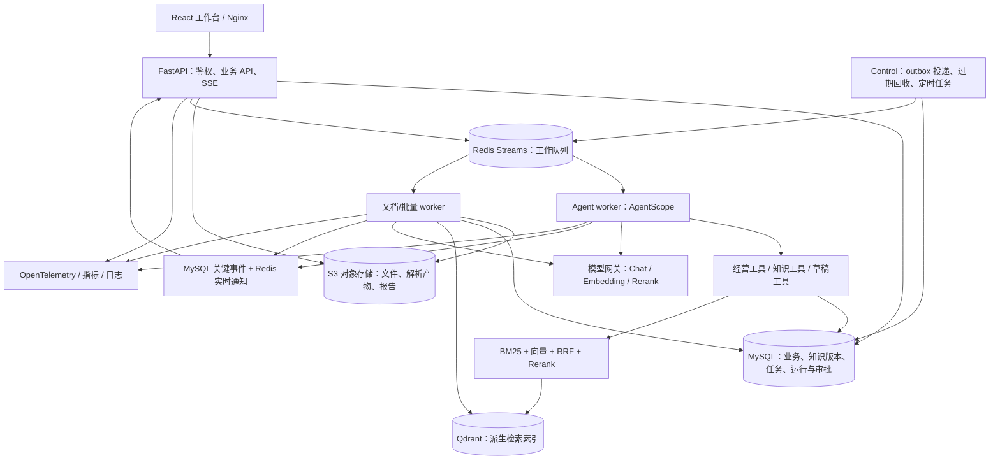

# SellerPilot v2 技术与实施方案

版本：v2 设计稿 1.0；日期：2026-10-19。

定位：面向多店铺的智能运营与知识管理平台。

状态：本文件是升级方案，新增能力均为待实现。当前结论来自本地代码和公开仓库静态核查；本次未运行 Globex、RAGFlow，也未重跑 SellerPilot 测试。原有测试结果仅按项目验收文档引用。方案文件生成在协作工作区，尚未写入 SellerPilot 仓库。

## 1. v2 要达到什么规模

v2 将 SellerPilot 从“经营后台 + 有界问答 Agent”扩展为具备知识生命周期、混合检索、多 Agent 协作、异步任务、人工审批、执行追踪和评测反馈的完整应用。扩展技术覆盖是明确目标，下面的主体模块都属于 v2 交付范围。

设计继承三部分：SellerPilot 的业务数据与执行边界；Globex 的 Agent 工程、缓存、任务与事件设计；RAGFlow 的文档处理、分块预览、检索测试和知识组织思路。知识管理和问答逻辑在 SellerPilot 内自行实现，不调用 RAGFlow 后端，不把 Globex 作为另一个在线服务。

### 1.1 三条旗舰演示流程

| 场景 | 用户操作 | 系统应完成的过程 |
| --- | --- | --- |
| 知识运营 | 上传店铺规则和产品手册，询问适用条款 | 异步解析、分块预览、版本发布、检索、带来源回答；替换资料后旧版本退出检索 |
| 经营诊断与行动 | “分析最近两周销售变化，找出需要调整标题的商品，按规则生成建议” | 查询两个时间段并按币种比较，检索标题规则，生成分析与草稿，人工审批后应用，保留依据与回执 |
| 持续运营 | 配置每日经营报告和低库存检查 | 定时创建任务、排队执行、失败重试、报告归档、任务状态查询和站内通知 |

销售下降等结论必须有两个可比较时间段和足够明细。没有曝光、点击、广告数据时，不推断转化率或广告成效；标题建议只能说明依据，不能承诺销量改善。

### 1.2 计划形成的技术栈

Python、FastAPI、Pydantic、SQLAlchemy、MySQL 8.4、Alembic、AgentScope、Qdrant、BM25、RRF、Embedding、Reranker、Redis Streams、S3 兼容对象存储、SSE、OpenTelemetry、Prometheus/Grafana、React/TypeScript、Docker Compose、GitHub Actions、pytest、Playwright。

这里的“自行实现”指自行设计并实现应用层流水线、检索策略、编排、状态、权限和评测。模型、解析库、向量数据库与框架使用成熟组件；对外描述应准确区分框架能力、参考设计与本人实现。

## 2. 当前基础与升级差距

本次读取本地 `D:/Project/SellerPilot` 的 README、后端关键模块、依赖、前端配置和验收文档。原技术方案中 PostgreSQL/pgvector 的描述已与当前实现不一致，v2 以当前 MySQL 代码为起点。

| 领域 | 当前已实现 | v2 需要新增 |
| --- | --- | --- |
| 账号与店铺 | JWT、owner 归属、商品 CRUD、低库存 | 店铺成员及角色、统一授权上下文、知识和任务权限 |
| 经营数据 | 订单/明细、两类 CSV、文件哈希去重、整批事务、分币种统计 | 异步导入、时间段对比、数据快照、定时报告 |
| Agent | 5 类只读工具、有界循环、参数重验、有限会话历史 | AgentScope 编排、多 Agent、持久化运行、预算、过程事件 |
| 知识 | 4 条共享自编政策、BM25、引用 ID 检查 | 上传/解析/分块、版本、索引、混合检索、重排、检索测试 |
| 运营动作 | 标题草稿、创建者确认、旧标题冲突检查、重复确认回执 | 批量建议、审批角色、动作状态、通用审计 |
| 前端 | 账号、店铺、商品、分析、聊天、导入、标题页面 | 知识中心、任务中心、Agent 时间线、审批、报告和评测页 |
| 工程 | MySQL Compose、迁移、基础测试与闭环测试 | Worker、对象存储、监控、故障恢复、CI、完整部署 |

当前 `conversations.py` 在读取会话后调用模型，再提交会话；v2 要拆成短事务，避免长模型调用一直占用数据库事务。当前 `products.sku` 为全局唯一，v2 应迁为店铺内唯一，并检查所有 SKU 查询是否带店铺范围。

原验收文档记录 9 项仓库测试及前端构建通过，但不代表所有历史专项脚本已纳入 CI，也不代表真实模型语义评测通过。v2 的回归基线需要重新建立。[本地验收记录](D:/Project/SellerPilot/docs/演示验收.md)

## 3. 如何结合 Globex 与 RAGFlow

### 3.1 参考能力与 SellerPilot 的落地变化

| 参考设计 | 本次核查的证据 | SellerPilot v2 的实现方向 |
| --- | --- | --- |
| Globex 主 Agent 与专家分工 | 编排器及 Agent 工厂 | Coordinator、Analyst、Knowledge、Planner；按问题路由，不要求每轮都启动所有专家 |
| Globex 向量召回、重排及降级 | `catalog_search.py` | 面向政策/手册的 BM25 + 向量 + RRF + 可选重排，保留实际策略记录 |
| Globex Redis 缓存 | `semantic_cache.py` | 向量缓存、版本化检索缓存、经营统计缓存；知识问答语义缓存作为受限增强 |
| Globex API/worker 分离、事件传播 | `redis_stream_queue.py`、`worker.py` | MySQL 任务状态 + Redis Streams + outbox + 租约恢复；SSE 展示业务事件 |
| Globex 上下文、偏好与预算 | `orchestrator.py`、`context.py`、`throttle.py` | 店铺任务上下文、可撤回偏好、调用预算、超时与限流 |
| Globex 检索对照评测 | `run_product_recall.py` | 自建知识/Agent 题集，比较检索策略和单/多 Agent，保留失败样例 |
| RAGFlow 文档流水线 | Dataset configuration | 可配置 Parser、Chunker、Enricher、Embedder、Indexer；预设模板替代首版画布 |
| RAGFlow 分块与检索检查 | Retrieval testing | 分块预览、来源定位、检索参数试验与配置发布 |
| RAGFlow 知识编译 | Knowledge compilation overview | 文档摘要、FAQ 与章节树；明确区分模型生成资料和原文证据 |

以上为设计映射，不表示参考仓库已完整实现本方案。[Globex 检索实现](https://github.com/baoerger/globex/blob/baa675bd418f3ea751aaa2f6997d72005ef434a2/app/application/usecases/catalog_search.py)、[编排实现](https://github.com/baoerger/globex/blob/baa675bd418f3ea751aaa2f6997d72005ef434a2/app/application/agents/orchestrator.py)、[RAGFlow 文档配置](https://github.com/infiniflow/ragflow/blob/7eb673bfc3ab1cc22532fe23a1e9bb85c34e48bd/docs/guides/dataset/configuration.md)

### 3.2 需要明确改进的参考边界

Globex 对齐清单把 Hybrid + RRF、Prompt A/B、数据反馈闭环和 Skill 渐进加载列为待办，不能作为其已完成能力继承。其评测脚本在未配置 Reranker 时提示重排档等价于向量档；SellerPilot 必须记录 `rerank_applied`，不能把配置名当作实际执行事实。[对齐清单](https://github.com/baoerger/globex/blob/baa675bd418f3ea751aaa2f6997d72005ef434a2/docs/教程实现对齐清单.md)、[评测脚本](https://github.com/baoerger/globex/blob/baa675bd418f3ea751aaa2f6997d72005ef434a2/scripts/eval/run_product_recall.py)

Globex 队列有 pending 认领函数，但本次查看的 worker 入口没有显示周期性调用；不能由此宣称崩溃任务已经自动恢复。v2 要把回收调度、消息 ID、ACK、重试次数和租约校验连成完整链路，并通过杀进程测试。

Globex 业务写工具在框架权限层显式允许，依赖对话层确认。SellerPilot 继续以服务端审批记录和确定性业务函数控制实际写入；模型文本中的“用户同意”不能代替审批。[队列实现](https://github.com/baoerger/globex/blob/baa675bd418f3ea751aaa2f6997d72005ef434a2/app/infrastructure/queue/redis_stream_queue.py)、[Worker 入口](https://github.com/baoerger/globex/blob/baa675bd418f3ea751aaa2f6997d72005ef434a2/app/worker.py)、[工具权限实现](https://github.com/baoerger/globex/blob/baa675bd418f3ea751aaa2f6997d72005ef434a2/app/application/agents/permissions.py)

## 4. 总体架构与技术决策

采用模块化单体代码库，多进程部署。API、Agent worker、文档 worker、调度/投递进程共用业务代码和数据合同。扩大功能与基础设施覆盖，同时保持一次本地启动和统一权限模型。



图中 API 提交任务的 Redis 连线表示投递链路，可靠提交实际通过 MySQL outbox 完成，不能先发消息再补数据库。

| 技术 | 决策与责任 |
| --- | --- |
| FastAPI、Pydantic | 继续使用；新增接口统一响应与错误码，保留现有业务路径兼容期 |
| MySQL 8.4、SQLAlchemy、Alembic | 继续作为业务事实来源；不因参考项目采用 SQLite 或旧方案而迁库 |
| AgentScope | 负责 Agent、工具和协作；首阶段验证 GLM 的工具调用、结构化输出和流式事件后锁定精确版本 |
| Qdrant | 共享 collection 按模型/维度分代，使用店铺/知识库过滤；索引可以从持久化资料重建 |
| BM25、RRF、Reranker | 在项目内实现检索管道；BM25 为词面基线，RRF 融合不同分值体系的排名 |
| Redis Streams | 统一异步工作队列；本版选用它而非再并行引入 Celery，任务恢复由项目实现并验收 |
| Redis 缓存 | 缓存可丢弃；不能作为审批、动作幂等和最终任务状态的唯一依据 |
| S3 兼容存储 | 原文及处理产物；本地采用 MinIO，业务只依赖对象存储接口，镜像版本通过启动试验固定 |
| SSE | 运行过程和结果推送；前端 fetch 流携带 JWT，服务端支持游标恢复 |
| OpenTelemetry、Prometheus/Grafana | 追踪一次请求到工具和模型的耗时；展示队列、错误率与运行成本 |
| React、TypeScript、Vite | 保留当前版本基线，新增知识/任务/审批等页面；异步服务状态可采用 TanStack Query 管理 |
| Docker Compose、GitHub Actions | 开发/演示环境编排，迁移、测试、前端构建、镜像检查与报告归档 |

旧业务函数继续使用同步 SQLAlchemy Session。Agent 的网络 I/O 可以异步；同步业务调用在线程工作函数内自行创建、关闭 Session，不跨线程或并行 Agent 共享 Session，不在模型等待期间持有行锁。[SQLAlchemy 会话约束](https://docs.sqlalchemy.org/en/20/orm/session_basics.html)

## 5. 功能模块与产品页面

### 5.1 知识中心

知识库按店铺创建，支持政策、产品手册、运营 SOP、FAQ 四类资料。v2 主流程覆盖 TXT、Markdown、文本型 PDF、DOCX；扫描 PDF 通过 OCR 适配器处理，显示页级失败与低质量提示。PDF/DOCX 使用成熟解析库，OCR 使用独立适配器，不承诺自行重现 DeepDoc 的全部版面识别质量。

页面提供知识库列表、资料上传、解析进度、文档详情、分块预览、原文定位、版本记录、启停/删除、重建索引、检索测试、摘要/FAQ。图片、复杂表格和多栏 PDF 需要单独样本验收，不能以“文件接受成功”代替内容解析正确。

### 5.2 Agent 工作台

支持历史会话恢复、运行时间线、数据卡片、引用卡片、计划状态、草稿卡片和取消请求。用户能看到哪个工具执行、使用了哪些来源、发生了什么降级；不展示模型私有思维链，计划和理由由结构化任务字段产生。

### 5.3 任务与报告中心

统一显示文档处理、CSV 导入、Agent 运行、批量标题建议和定时报告。支持按状态筛选、任务详情、失败原因、有限重试、取消、父子任务进度和报告下载。任务级取消不自动撤销已经完成的独立动作。

定时报告按店铺时区确定业务日期，落库统一 UTC；`schedule_id + planned_fire_time` 唯一，防止调度进程重启重复生成。报告标注数据版本、知识版本、币种和统计区间。

### 5.4 审批与团队协作

新增店铺角色 owner、operator、viewer：viewer 可读，operator 可上传资料、运行 Agent 和生成草稿，owner 可管理成员并批准商品变更。现有店主自动成为 owner，现有创建者确认规则在数据迁移后再扩展到 owner 审批。

新增统一 `require_store_permission(user_id, store_id, capability)`；原来只检查 owner 的业务服务逐项迁到能力检查，不能只在前端加角色菜单。迁移成员关系、SKU 唯一约束和产品版本前，先核对历史空店铺关联及重复记录；无法自动归属的记录进入明确的迁移处理清单，不猜测所属用户。

v2 保留并扩展标题变更这一真实动作，支持批量逐项审批、拒绝、冲突和回执；增加补货建议与经营报告，但补货仅生成建议，不假装接通供应商采购。SKU 改为店铺内唯一、商品增加业务版本号，为可靠变更打基础。

### 5.5 评测与运行面板

提供检索策略对比、问题反馈、bad case 标记、Prompt 版本、耗时/模型调用/Token/错误统计。Prompt A/B 先做离线同题集对照，通过后再考虑在线分流；反馈不能直接自动改写线上 Prompt。

## 6. 文档处理与版本发布

### 6.1 自行实现的流水线

`接收文件 → 保存原文 → 创建处理任务 → 解析 → 清洗 → 分块 → 可选知识增强 → 向量化 → 写索引 → 校验 → 发布版本`

| 阶段 | 输入 | 输出与检查 |
| --- | --- | --- |
| Parser | 文件对象、解析配置 | 文本块、标题层级、页码/段落、表格与解析警告 |
| Cleaner | 解析块 | 合并断行、识别页眉页脚；保留原文映射，不删除关键编号和否定词 |
| Chunker | 结构化内容、模板 | chunk、parent、来源位置和 token 数 |
| Enricher | 原文片段 | 可选摘要、关键词、FAQ、章节树，标记为模型生成及其原始来源 |
| Embedder | chunk、模型配置 | 批量向量、维度、模型和输入哈希；逐批重试与进度 |
| Indexer | chunk 与向量 | Qdrant points、关键词检索快照、构建清单 |
| Publisher | 完成的构建版本 | 发布指针、知识版本递增、缓存失效事件 |

所有任务保存 pipeline、parser、chunker、embedding 和 prompt 版本。重复上传的去重键包含店铺、知识库、文件哈希和处理配置；相同文件换分块/模型属于新构建。

### 6.2 分块策略

政策按章节/条款分块，保留适用范围和例外条件；手册按标题与段落组织，长段落再按 token 切分；FAQ 按问答对；表格保留表头与行对应关系。初始窗口可试验 400–800 token、重叠 50–100 token，这只是调参起点，不是固定最优值。

child chunk 用于召回，parent 用于补充上下文，补充后仍标明真实来源位置。原文修订通过新文档版本完成；分块编辑产生新索引构建，不直接修改正在服务的文本和向量。

RAGFlow 提供按资料类型配置解析与分块的设计参考；SellerPilot 的模板和实现由本项目维护。[RAGFlow 文档配置](https://github.com/infiniflow/ragflow/blob/7eb673bfc3ab1cc22532fe23a1e9bb85c34e48bd/docs/guides/dataset/configuration.md)

### 6.3 发布、重建与删除

知识库维护 `active_build_id`。一个 build manifest 固定全部可见文档版本、配置和模型。向量和关键词快照先按新 build 构建并验收，再在 MySQL 短事务内切换 active 指针；一次检索先固定 build，整个调用不混用版本。

大 build 可复用已缓存的向量，但新 build 的可见集合必须完整。初版采用知识库级构建快照，换取实现清楚；后续再优化增量 manifest，避免首版同时处理跨存储原子更新。

删除/禁用资料时先在 MySQL 标为不可见并递增知识访问版本，检索结果在交给模型前按当前可见记录再次校验；Redis 缓存命中也必须经过这一步。旧索引异步清理，不能依赖“后台删除最终会完成”来阻止泄漏。查询只拉取当前允许范围，必要时补召回以处理被剔除片段。

构建失败保留旧 active build；可以重试失败阶段。被替换的旧 build 保留一段可配置时间用于回滚；删除权限数据的历史正文只允许授权审计访问，不作为普通问答回放来源。

### 6.4 知识增强范围

v2 实现摘要、FAQ、章节树，增加一条从原文到结构化知识的生成链。生成资料主要用于导航和召回扩展，回答中的权威依据回溯到原文。知识图谱、多跳图检索和可视化画布作为 v2.1 扩展，不计入 v2.0 主体验收。[RAGFlow 知识编译](https://github.com/infiniflow/ragflow/blob/7eb673bfc3ab1cc22532fe23a1e9bb85c34e48bd/docs/guides/knowledge_compilation/overview.md)

## 7. 混合检索与问答证据

### 7.1 检索步骤

1. 从认证身份和目标店铺获得允许访问的知识库；确定 active build、资料类型、平台、语言及有效时间。
2. 对问题做有限改写，保存原问题；型号、SKU、条款编号、数量、时间和否定条件不能被悄悄丢弃。
3. 同时执行 BM25 和向量检索，各先取候选，例如 30 条；两个通道必须使用同一权限范围和 build。
4. 按 chunk ID 去重，以 `sum(1 / (k + rank))` 做 RRF，初始 `k=60`；保留融合前后排名供诊断。
5. 对融合候选执行 Rerank，保留例如 5 条；阈值按独立标注集校准，不能沿用 BM25 分数阈值。
6. 补充必要父片段，检查资料可见性和版本，再输出证据对象。

BM25 首版使用从已发布 chunks 构建的分词倒排快照，由项目内检索器提供；快照写对象存储，worker/API 按 build 加载，按知识库懒加载并限制内存。不为首版另开 Elasticsearch 服务。该方案的单机/多进程内存成本必须在扩量测试中记录。

Qdrant collection 按 embedding 模型及维度分代，payload 保存店铺、知识库、build、文档版本和 chunk ID，对过滤字段建索引。数据库过滤能力不是应用权限的替代品，调用前后都要有服务端范围校验。[Qdrant 多租户设计](https://qdrant.tech/documentation/manage-data/multitenancy/)

上述候选数、RRF 参数和窗口均为待校准默认值。需要比较 BM25、向量、混合、混合+重排四种实际执行策略。[RAGFlow 检索测试参考](https://github.com/infiniflow/ragflow/blob/7eb673bfc3ab1cc22532fe23a1e9bb85c34e48bd/docs/guides/dataset/retrieval_testing.md)

### 7.2 证据合同

统一 `Evidence` 至少包含：`evidence_id`、`store_id`、`dataset_id`、`document_id`、`document_version_id`、`build_id`、`chunk_id`、`text`、`page/section`、`source_kind`、`retrieval_strategy`、`score`。源类型区分演示资料、用户上传原文、外部资料和模型生成资料。

回答保存逐结论的 `claim + evidence_ids`；经营数字还要包含 `tool_result_id`、统计区间、币种与数据版本。服务端校验结构、来源权限、版本和引用 ID，语义是否受证据支持通过规则、人工标注和评测进一步检查。不能把“引用 ID 合法”等同于“答案必然正确”。

问题中的各子问题分别返回 `answered`、`insufficient_evidence` 或 `conflicting_sources`。例如销售数据能查到而退货规则不足时，保留有效销售结论，明确规则部分无法确认；不沿用当前“政策不足则整轮统一替换”的限制。

对“已经检索但模型没有生成有效引用”的情况保留当前受控失败语义；新的状态合同不能把所有格式错误都包装成正常拒答，以免隐藏运行缺陷。

### 7.3 降级与拒答

| 故障/情况 | 行为 |
| --- | --- |
| Reranker 不可用 | 返回混合排序，标记 `rerank_applied=false` 和原因 |
| Embedding/Qdrant 不可用 | 使用当前 build 的 BM25，标记降级；无法获取同版本快照则报告不可用 |
| 无足够证据 | 返回对应子问题资料不足，不补造条款 |
| 多份有效资料矛盾 | 展示冲突来源与适用范围，请用户确认权威版本 |
| 权限校验/版本快照失败 | 终止该知识查询，不能退到全库搜索 |
| 检索到指令式恶意内容 | 作为不可信资料处理，不增加工具权限或改变审批要求 |

## 8. AgentScope 融合与运行机制

### 8.1 角色与工具边界

| 角色 | 负责什么 | 可用工具 |
| --- | --- | --- |
| Coordinator | 识别意图、制定有限计划、分派、汇总 | 路由、读取专家结果、管理任务状态 |
| Analyst | 库存、订单、销售对比和异常解释 | 现有经营工具、新增时间段对比与数据快照 |
| Knowledge | 检索规则和产品资料、检查证据覆盖 | 知识检索、文档定位、版本查询 |
| Planner | 根据数据与规则提出运营建议和草稿 | 创建建议/标题草稿；不能执行已审批动作 |
| 服务端校验器 | 身份、参数、引用、预算和动作验证 | 确定性代码，不是另一个模型角色 |

单一库存问题直接由现有工具完成；复杂经营问题可并行查询数据和知识，再顺序生成计划。所有子 Agent 共享一个运行级预算，限制调度深度和子任务数，不允许通过子 Agent 重新获得一份预算。[AgentScope 路由参考](https://doc.agentscope.io/tutorial/workflow_routing.html)

### 8.2 与当前实现的衔接

先定义 `AgentRunner` 输入输出合同，再为现有手写循环和 AgentScope 分别实现适配器。两个 runner 只在迁移/对照期共存，使用同一工具服务与评测；验收后保留一个生产默认实现，旧实现留在版本历史或评测基线中。

`SearchPolicy` 的既有外部工具合同先保留，内部调用新知识服务；等前端与题集切换后升级为 `search_store_knowledge`。当前 4 条演示政策转成独立 demo dataset，来源标签不变，不能自动当作真实平台规则。

首阶段用 GLM 完成一次工具调用、一次结构化答案、一次流式事件、一次专家委派的兼容性试验。根据试验锁定 AgentScope 与依赖版本；参考项目的 `>=2,<3` 是它的依赖声明，不直接当作 SellerPilot 的可运行性证明。

### 8.3 身份、事务与会话

`RunContext` 由服务端构造，含用户、店铺、角色、conversation/run ID、授权范围、时区、币种、数据版本和知识快照。模型只能提供业务参数，不能决定 user/store scope。队列消息只携带任务标识与校验版本，worker 执行前重新加载身份与权限，避免撤权后继续执行。

会话处理拆成：短事务读取/保留本轮序号 → 释放 Session → 执行 Agent（每个工具自己的短事务）→ 短事务保存消息与运行结果。同一会话同时只允许一个活动 turn，由 MySQL 条件更新/唯一约束控制，不靠进程内字典。并行工具返回不同 data_version 时标注不一致并重读，不能伪装成同一快照。

### 8.4 长期偏好与上下文

将“输出语言、报告详细程度、常用分析区间”等稳定偏好与“实时库存、订单状态”等业务事实分开。偏好按用户/店铺保存，提供查看、修改、删除和来源记录；删除递增 `memory_version`，相关缓存立即失效。

短期上下文保留近期问答，长历史生成带来源消息范围的摘要。重试、摘要和恢复不能重复追加用户消息。历史工具返回不能代替本轮重新查询实时经营数据。

### 8.5 模型网关与预算

封装 chat、embedding、rerank 调用，统一超时、有限重试、usage、模型版本和错误。只对短暂网络/限流故障重试，参数和权限错误不重试。流式请求的并发名额持有到流关闭；多 worker 的全局模型额度使用 Redis 原子配额，进程内 semaphore 只限制本进程。

每轮配置最大模型次数、工具次数、委派次数、时间和 Token 预算，起点例如 8 次模型、10 次工具、2 层委派、180 秒；在兼容性和质量评测后调整。预算耗尽返回部分结果和未完成项。禁止通过整轮盲目重试重复创建草稿或执行动作。

## 9. 异步任务、可靠队列与事件流

### 9.1 一套队列、多类任务

任务类型包括 `agent_run`、`document_ingest`、`csv_import`、`batch_title_draft`、`daily_report`、`index_cleanup`。Redis Streams 分 agent 和 ingestion/batch 两个流，独立 worker 并发与资源上限，避免 OCR 堵住聊天。不承诺仅按流读取顺序即可获得严格优先级或公平性。

MySQL `jobs` 是任务状态事实来源：`queued → running → succeeded/failed/cancelled`，暂时失败经 `retry_wait → queued`。持有 `attempt`、`lease_owner`、`lease_until`、`fencing_token`、`next_attempt_at`、错误类型、取消标记及幂等键。

### 9.2 提交、执行和崩溃恢复

1. API 在一个 MySQL 事务中创建 job 和 outbox 记录，提交后返回 202 与 job/run ID。
2. 投递进程扫描 outbox，向 Stream 发送 job ID。数据库提交成功但 Redis 不可用时持续重试；发送成功后进程崩溃可能重复投递，因此不承诺 exactly-once。
3. Worker 使用条件更新领取数据库租约并递增 fencing token。重复消息发现任务已经终态或已有有效租约，按当前状态处理，不能重复执行业务写入。
4. Worker 定期续租，关键阶段保存检查点；完成时用 fencing token 提交结果、关键事件和状态，提交成功后才 ACK 当前 Stream message ID。
5. Control 周期执行过期租约扫描及 XAUTOCLAIM，覆盖每条工作流的 pending。回收时保留原 message ID，旧 worker 的过期 token 不允许提交。
6. 暂时错误记录下次重试时间，重新投递；超过次数进入失败/死信记录。人工重试创建带 `retry_of` 的新 job，保留原失败记录。
7. Redis 丢失消息时，MySQL 中可投递且无有效租约的任务由恢复扫描重新入队；活跃 pending 消息不能被无条件裁剪。

外部模型请求可能在崩溃后被再次调用并产生重复费用，队列无法消除这种不确定性。文档产物使用确定性路径/ID，写动作使用数据库幂等键；已提交业务动作不会因为消息重投再次生效。[Redis XAUTOCLAIM](https://redis.io/docs/latest/commands/xautoclaim/)

创建草稿、报告、子任务同样是写操作，其唯一键绑定店铺、父 run/job、逻辑步骤和目标对象；相同执行重试复用已提交产物。取消采用协作方式：阶段边界和提交前检查取消标记，已经发送的外部模型请求未必能撤回，已完成审批动作不自动回滚。界面区分“请求取消”和“已经取消”。

异步 CSV 沿用原内容哈希去重和整批事务语义：解析校验可在事务外，写入仍短事务提交。大文件达到当前处理上限则拒绝并给出明确限制；后续分块提交要另定义部分成功语义，不能悄悄改变现有承诺。

### 9.3 事件与 SSE

事件类型包括 `run.queued`、`run.started`、`plan.updated`、`tool.started/completed`、`retrieval.completed`、`model.degraded`、`draft.created`、`answer.preview`、`answer.final`、`run.completed/failed/cancelled`。

持久化业务事件包含 `event_id`、run/job ID、store ID、seq、attempt、类型和脱敏 payload，按 run 内 seq 唯一。先落 MySQL 再通知；Redis Pub/Sub 只作低延迟唤醒，不能用于可靠回放。模型 token 可聚合为临时预览，不要求每个 token 写数据库；最终答案完成校验并落库后才发送 final/complete。

前端通过 `fetch GET /api/v2/runs/{id}/events?after_seq=N` 携带 Bearer JWT，读取 `text/event-stream`；重连重新鉴权并从 seq 补取。切换店铺取消旧订阅，断网不取消后台任务；取消使用独立接口。新订阅先取持久事件/状态，再接通知并周期补查以消除订阅窗口丢失。Nginx 关闭流式缓冲，配置心跳和连接上限。[SSE 格式参考](https://developer.mozilla.org/en-US/docs/Web/API/Server-sent_events/Using_server-sent_events)

## 10. 缓存、版本与故障边界

| 缓存对象 | Key 必须包含 | 失效与降级 |
| --- | --- | --- |
| 文本向量 | 模型/维度、输入哈希、规范化版本、店铺命名空间 | 换模型或输入即新 key；Redis 失败直接调用模型 |
| 检索结果 | 店铺、授权范围、build、query、filter、retrieval 配置版本 | 发布/撤权/禁用版本变化失效；命中仍复核 chunk 可见性 |
| 经营统计 | 店铺、data_version、区间、状态/币种/筛选 | 业务写入版本变化即失效，TTL 控制垃圾 key；失败查 MySQL |
| 问答语义缓存 | 店铺、权限、build、模型/Prompt、memory_version | 仅独立知识问题可用；上下文依赖、实时数据和写意图禁止使用 |

先交付前三类缓存，语义缓存作为 v2 后半段受限功能，单独统计错误复用率。缓存相似度阈值不能作为答案正确性阈值。基准评测默认关闭答案缓存，缓存收益实验单独运行。

`data_version` 的增量必须覆盖所有影响缓存的写入，包括商品 CRUD、库存修改、订单/明细导入和标题确认。增加缓存前先审计当前写路径；在同一事务中更新数据和版本。知识授权和可见性另用 knowledge/access version，成员撤权用 access version。

开发环境可共用 Redis，但使用 noeviction、缓存条数/大小/TTL 限制和内存监控，避免缓存挤掉队列；部署压力上升时拆成 queue/cache 两实例。Redis 队列故障时新 job 可保持 queued 等待恢复，不能暗中改为 API 内执行。

## 11. 审批、动作与审计

Planner 只生成 `action_proposal`，字段包括动作类型、目标商品、旧值/建议值、产品版本、数据/知识快照、依据、创建者和状态。v2 的实际执行类型先固定 `update_product_title`，按类型编写确定性执行函数。

`pending → approved → executing → applied`；也可进入 `rejected/conflicted/failed/cancelled`。批准人、批准版本、批准时间落库，批准仅适用于当时的 proposal payload hash；修改建议必须重新审批。

确认/应用在 MySQL 事务中锁定 proposal 和目标商品，检查权限、状态、产品版本及建议哈希，将商品更新、动作回执、audit log、data_version 和 outbox 一起提交。重复执行返回原回执，不把已变化的商品恢复为旧建议。

批量审批采用逐项事务，父任务记录成功/冲突/失败，界面明确部分成功，不声称整批原子。对已生效动作的撤销是新的反向建议和审批，不能通过删除审计或简单重放旧值实现。

现有 `product_title_drafts` 先加 proposal 关联，逐步迁到统一流程；兼容期避免两套接口对同一草稿双重执行。原草稿历史保留，原接口调用统一执行服务。

## 12. 数据模型与接口合同

### 12.1 新增/扩展实体

| 领域 | 表/实体 | 关键约束 |
| --- | --- | --- |
| 账号与商品 | store_members、products.version、store.access_version | 店铺/成员唯一；SKU 按店铺唯一；owner 迁移可追溯 |
| 知识 | knowledge_bases、documents、document_versions | 店铺归属、文件哈希、来源类型、处理配置与可见性 |
| 索引 | index_builds、build_documents、knowledge_chunks | build 固定文档版本集合；chunk 稳定 ID、父子与来源位置 |
| 任务 | jobs、job_attempts、outbox_events、schedules | 作用域内幂等、租约、fencing token、计划触发唯一键 |
| Agent | agent_runs、run_steps、run_events、conversation_messages | run/seq 唯一、父子运行、版本快照、状态与 usage |
| 记忆 | user_preferences、conversation_summaries | 用户/店铺范围、来源与版本、撤回记录 |
| 动作 | action_proposals、action_executions、audit_logs | payload hash、业务幂等、目标版本、审批人和回执 |
| 评测与报告 | feedback、prompt_versions、eval_runs、reports | 题集/代码/模型版本、结果文件、对应 run/job |

外键/联合约束阻止跨店铺关联，查询仍必须带作用域。MySQL 是状态事实来源，Qdrant/关键词快照是派生数据；对象文件与数据库用状态和清理任务协调，不能假装支持跨存储事务。`documents` 与知识库的作用域不可由客户端任意改绑。

### 12.2 新 API 族

| API | 目的 |
| --- | --- |
| `POST/GET /api/v2/stores/{sid}/knowledge-bases` | 创建、列出店铺知识库 |
| `POST /api/v2/stores/{sid}/knowledge-bases/{kid}/documents` | 上传文件并创建处理 job |
| `GET /api/v2/stores/{sid}/documents/{did}` | 文档、版本与处理进度 |
| `GET /api/v2/stores/{sid}/documents/{did}/chunks` | 分块预览及来源 |
| `POST /api/v2/stores/{sid}/knowledge-bases/{kid}/builds` | 重建/发布新索引构建 |
| `POST /api/v2/stores/{sid}/knowledge-bases/{kid}/retrieval-tests` | 检索试验，返回各阶段排名与耗时 |
| `POST /api/v2/stores/{sid}/agent/runs` | 提交运行，返回 202、run/job ID |
| `GET /api/v2/runs/{rid}`、`GET .../{rid}/events` | 查状态、结果和 SSE；从数据库反查店铺并鉴权 |
| `POST /api/v2/runs/{rid}/cancel` | 请求取消运行 |
| `GET /api/v2/stores/{sid}/conversations`、`GET .../conversations/{cid}` | 历史会话恢复 |
| `GET /api/v2/stores/{sid}/jobs`、`POST .../jobs/{jid}/retry` | 任务中心及重试 |
| `POST /api/v2/stores/{sid}/title-batches` | 创建批量标题建议 |
| `POST /api/v2/stores/{sid}/actions/{aid}/approve`、`POST .../{aid}/reject` | 审批并进入确定性执行链 |
| `GET/POST/DELETE /api/v2/stores/{sid}/preferences` | 偏好管理与撤回 |
| `GET/POST /api/v2/stores/{sid}/schedules` | 定时报告配置 |
| `POST /api/v2/runs/{rid}/feedback` | 回答反馈和问题类型标注 |

接口表是设计合同，不是现有接口清单。分页、文件大小、超时、幂等键作用域、409/422/503 等错误在各模块实施前写入 OpenAPI 与验收例子。重试、审批等带副作用接口必须检查请求幂等键；重用同一 key 携带不同 payload 返回冲突。

## 13. 代码组织与迁移边界

```text
SellerPilot/
├── backend/
│   ├── main.py                     # 保留现有启动入口
│   ├── migrations/                 # 沿用 Alembic 历史
│   ├── routers/                    # 原业务路由逐步接入新模块
│   ├── modules/
│   │   ├── knowledge/              # 文档、版本、处理流水线
│   │   ├── retrieval/              # BM25、向量、RRF、重排、证据
│   │   ├── agent_runtime/          # runner、角色、工具、上下文、预算
│   │   ├── tasks/                  # 任务、重试、租约、outbox
│   │   ├── actions/                # 建议、审批、执行、审计
│   │   ├── reports/                # 定时报告、归档与通知
│   │   └── evaluation/             # 评测合同、反馈、Prompt 版本
│   ├── infrastructure/             # Redis/Qdrant/S3/模型/追踪适配
│   ├── workers/                    # agent、ingestion、control 入口
│   ├── tests/                      # unit/integration/e2e
│   └── scripts/                    # seed、重建、恢复、基准运行
├── frontend/src/features/          # 保留旧模块，新增 knowledge/jobs/runs/approvals/reports
├── eval/                           # 冻结题集、标注合同、报告模板
├── deploy/                         # Compose、Nginx、观测 profile
├── docs/                           # ADR、接口合同、验收、故障实验
└── .github/workflows/              # CI 与受控真实模型评测
```

新增模块内部按 routes/schema/service/repository 划分，核心业务不导入 FastAPI Request、Redis client 或 AgentScope 事件对象。外部框架对象在适配层转换为项目数据合同。只为有实际替换/测试需要的边界定义接口，不机械给每个函数建立四层类。

先迁新增知识、任务和 Agent 运行模块；已有 orders/products/analytics 通过服务适配复用，不在第一轮同时重写。现有 `schemas.py`、`models.py` 根据模块迁移逐步拆分，避免一次性移动全部文件导致无法核对行为。

## 14. 分阶段实施与验收

按单人业余开发估算，完整 v2 约需 12–16 周、240–400 小时。该范围包含学习、联调、评测和交付，是规划估计，兼容性、OCR 与故障恢复可能增加工时。不是原先六周 MVP 方案的简单延长。每阶段保持主分支可启动，整体 v2 范围不因分阶段而缩成一次检索替换。

| 阶段 | 主要交付 | 完成标准 |
| --- | --- | --- |
| M0 基线与兼容性，约 1 周 | v1 基线、独立测试数据、AgentScope/GLM/Qdrant/S3 试验、依赖锁 | 原业务回归通过；真实工具/结构化/流式探针有记录；版本固定 |
| M1 任务底座，约 2 周 | jobs/outbox、Streams、两类 worker、租约与回收、任务页 | 提交后 Redis 故障不丢 job；杀 worker 后恢复；重复投递不重复业务提交 |
| M2 知识管理，约 2–3 周 | 文件与元数据、解析分块、版本构建、预览/OCR、删除 | 文本及扫描样本可定位原文；构建失败不影响旧版；禁用后不再泄漏 |
| M3 检索，约 2 周 | BM25/向量/RRF/Rerank、检索试验、引用结构、缓存 | 四策略同题集可对照；跨店铺/版本过滤正确；降级状态真实 |
| M4 Agent 平台，约 2–3 周 | AgentScope、角色协作、短事务、历史恢复、SSE、偏好 | 简单/复杂任务正确路由；会话并发不覆盖；断线可恢复最终结果 |
| M5 运营执行，约 2 周 | 批量草稿、审批、审计、日报/低库存调度、知识摘要/FAQ | 并发确认最多一次生效；过期建议冲突；定时重启不重复创建 |
| M6 交付，约 1–3 周 | 观测面板、反馈与 Prompt 对照、完整部署、基准/故障报告 | 空库/旧库升级、备份恢复、真实模型与浏览器演示均有范围明确的报告 |

估算阶段存在并行与迭代，不应把每行最小/最大值机械相加当成承诺。评测样本和测试从 M0 开始积累，M6 执行冻结版本验收。

建议里程碑标签采用 `v2.0.0-alpha.1`（任务）、`alpha.2`（知识）、`alpha.3`（检索）、`beta.1`（Agent）、`beta.2`（运营）、`v2.0.0`（验收）。v1 当前实际发布标签未核实，不假设已有某个 tag。

## 15. 评测、测试与完成定义

### 15.1 数据集与策略对照

自建首批 50–100 份代表性资料，目标形成约 500–2000 个有意义片段，实际数量按资料而定。资料分店铺、类型、平台、版本；加入相似条款、例外条件、冲突和无答案问题。演示资料继续显式标注，真实资料记录来源与日期。

检索/问答至少 150 题：词面 30、语义改写 30、多条款/多文档 15、版本/适用范围 15、无答案 30、跨店铺与权限 30。权限题单独判定是否泄漏，不混进普通 Recall。固定开发/保留测试集，保留测试集不用于选阈值；模型生成题须人工复核标准证据。

Agent 至少 60 个场景，覆盖单工具、多工具、数据+知识、追问、草稿、工具失败、预算耗尽和冲突。比较现有单 Agent 与 AgentScope 单 Agent，再比较选择性专家协作，避免把“接入框架”和“多 Agent”混为同一个变量。

### 15.2 指标与建议门槛

| 层面 | 指标/实验 | 初始验收目标，均待实测 |
| --- | --- | --- |
| 检索 | Recall@5、MRR、NDCG@5，按问题类型分组 | 可回答题 Recall@5 目标不低于 0.85；多策略不得仅报告汇总均值 |
| 引用 | ID、权限、版本合法性与逐结论支持率 | 结构和权限检查全部通过；人工标注支持率目标不低于 0.90 |
| 拒答 | 无答案/矛盾题的正确处理率，同时统计误拒答 | 正确处理目标不低于 0.90，避免靠全部拒答获得高分 |
| Agent | 工具选择、任务完成率、事实数字与错误处理 | 固定题集完成率目标不低于 0.85；经营金额须与确定性结果一致 |
| 权限与动作 | 跨店铺访问、撤权、重复/并发确认 | 指定测试集零泄漏、零重复生效；这不是对所有未知输入的绝对保证 |
| 性能 | API/检索/run 的 p50/p95、吞吐、排队和模型耗时 | 冻结同硬件/数据/并发后定门槛，不预先声称高并发性能 |
| 成本 | 每任务请求数、Token、重试、缓存收益 | 与同题基线比较；价格未知时只报告 usage，不编造金额 |

记录代码提交、数据版本、模型/Prompt、检索参数、实际降级、缓存开关、环境和失败样例。Reranker 未运行的试验不得命名为“重排效果提升”。多 Agent 未提高完成率时，可按任务路由调整，但不隐瞒对照结果。

### 15.3 必须做的故障与一致性实验

1. MySQL job 提交后、Redis 投递前停进程，重启能恢复。
2. worker 领取后被杀、结果提交后 ACK 前被杀，两种情况都不重复业务提交。
3. worker 租约过期后旧进程恢复，旧 fencing token 无法覆盖新结果。
4. 新索引只写一半时失败，旧 build 仍服务；发布前后一次检索不混版本。
5. 缓存命中后撤权/禁用/删除，重新验证不会返回失效资料。
6. Rerank、Embedding、Redis 分别故障，界面与日志显示实际降级或等待。
7. 同会话双提交、两个审批竞争、不同草稿修改同一商品，产生明确冲突或唯一回执。
8. SSE 断线、API 重启和切店，最终结果可恢复且无跨店铺事件。
9. 日报触发前后重启调度器，同一计划时刻只产生一份有效任务/报告。

单元测试覆盖计算、状态转换、参数和融合；集成测试使用真实 MySQL/Redis/Qdrant/对象存储验证合同；浏览器端用 Playwright 测三条旗舰流程。Mock 模型测试与真实模型评测分开统计；单次历史跑通不能代替本阶段回归。

## 16. 部署、资源与运行观测

### 16.1 一套应用、多种进程

核心 Compose 建议包含 `web`、`api`、`worker-agent`、`worker-ingestion`、`control`、`mysql`、`redis`、`qdrant`、`object-storage`，共约 9 个容器。Control 运行 outbox、回收和调度，首版单实例；多实例必须用数据库租约选主，不能只依赖进程内标志。

API、两个 worker 和 control 来自同一 SellerPilot 镜像、不同命令。只有一个业务后端代码库，不启动 Globex 或 RAGFlow。数据库/向量/对象存储是基础设施，使用 Docker Desktop 的同一个引擎即可。

本地开发可让前后端在宿主机运行、依赖和 worker 在 Linux 容器运行；连接地址按进程所在位置分别配置。容器访问同网络服务名，宿主机访问映射端口，不把 localhost 混用。完整部署统一 Linux 容器，公开入口由 Nginx 提供。

核心应用可用 `observability` profile 追加 Collector/Jaeger、Prometheus、Grafana。首批机器预算可按 4–8 核、16 GB 内存起步，启用 OCR、监控和批量任务时优先评估 32 GB；这是待基准验证的容量假设，不是实测最低要求。Chat/Embedding/Rerank 首版使用模型 API，CPU 开发机不承担本地大模型加载。

### 16.2 可观测性与维护

Trace 连接 API → job → Agent/解析阶段 → tool → model；队列上下文显式传递 trace 标识。日志包括 request/run/job/store、attempt、耗时、错误码和版本，默认不记录密钥、完整文档和未脱敏工具输入。界面只显示可授权访问的运行记录。[OpenTelemetry Python](https://opentelemetry.io/docs/languages/python/)

Prometheus/Grafana 展示队列等待、执行时长、失败/重试/死信、模型限流、检索降级、缓存命中、Token 和任务取消。模型服务不提供 usage 时标为缺失或估算，不能显示精确计费。

MySQL 与对象存储备份是恢复基础；索引可重建，恢复后应校验 active manifest。Redis 启用持久化但仍演练从 MySQL 恢复待办。发布采用向前兼容迁移、镜像和依赖锁，至少验证一次备份恢复和旧库升级。

### 16.3 CI 与交付

PR：后端格式/静态检查、unit、真实基础设施 integration、迁移检查、前端类型/构建、关键 Playwright；耗时较大的浏览器/故障全量套件可在主分支或手动执行。真实模型评测手动触发、设置预算、结果归档，普通 PR 不需要模型密钥。

交付包括启动与迁移文档、架构图、功能截图、三条录屏、冻结题集与对照报告、故障恢复报告、环境与版本清单、已知限制。所有命令在实现后从新目录/空卷演练，不能把本方案里的接口/目录当成已存在的执行命令。

## 17. 第一轮实施清单与长期扩展

### 17.1 第一轮应实际完成的工作

1. 在项目仓库中添加本方案和 ADR，记录六项决策：MySQL 保留、AgentScope、Redis Streams、知识 build 发布、SSE、服务端审批。
2. 用独立测试库重跑 v1 现有测试和前端构建，整理历史脚本中必须纳入仓库的权限/幂等/并发案例。
3. 建立精确依赖锁并运行 AgentScope/GLM、Qdrant、对象存储四项兼容性探针；不在尚未验证版本时搬整个 Agent。
4. 实现 jobs、outbox、Stream consumer 和任务页的最小完整链，包含一次 worker 被杀后的恢复实验。
5. 第一份知识文档通过同一任务链进入解析/分块预览，为后续索引与 Agent 提供基础。

这是完整 v2 的启动阶段，后续 M2–M6 均保留在计划中。实施时每次交付可检查的模块，但不再将总体目标限制为只修改一个检索函数。

### 17.2 v2.1 扩展池

知识图谱和多跳检索、可视化流水线画布、Skill 渐进加载、站点内容同步、真实电商平台适配器、在线 Prompt A/B、独立检索引擎、Text-to-SQL 沙箱。每项根据已形成的数据、样例与接口再设计；这些不作为 v2.0 发布必要条件，也不提前写成已完成能力。

### 17.3 未来简历中可以成立的表达

完成并验证后，可围绕“多租户智能运营平台”“文档版本化与混合检索”“AgentScope 协作与运行治理”“可靠后台任务”“人工审批与并发一致性”组织项目经历。数字只能来自冻结报告；使用框架不写成自研框架，参考架构不写成原创算法。

示例叙述方向：在现有卖家业务后端上，自行实现文档处理与版本发布、BM25/向量融合检索和带引用问答；以 AgentScope 组织经营分析与知识检索，以 Redis Streams/outbox 和数据库租约实现可恢复任务；对标题变更实行审批、版本检查和幂等执行，并建立检索、Agent、并发及故障评测。当前这段是目标描述，不是现有成果。

## 18. 参考快照与阅读索引

### 18.1 参考仓库

Globex 本次核实的默认分支提交：`baa675bd418f3ea751aaa2f6997d72005ef434a2`。核查为静态读取，不引用它的报告数字作为 SellerPilot 效果。

- [G1：项目定位与结构](https://github.com/baoerger/globex/blob/baa675bd418f3ea751aaa2f6997d72005ef434a2/README.md)
- [G2：检索与降级](https://github.com/baoerger/globex/blob/baa675bd418f3ea751aaa2f6997d72005ef434a2/app/application/usecases/catalog_search.py)
- [G3：Agent 编排、缓存与事件](https://github.com/baoerger/globex/blob/baa675bd418f3ea751aaa2f6997d72005ef434a2/app/application/agents/orchestrator.py)
- [G4：工具权限](https://github.com/baoerger/globex/blob/baa675bd418f3ea751aaa2f6997d72005ef434a2/app/application/agents/permissions.py)
- [G5：语义缓存](https://github.com/baoerger/globex/blob/baa675bd418f3ea751aaa2f6997d72005ef434a2/app/infrastructure/cache/semantic_cache.py)
- [G6：队列和事件背板](https://github.com/baoerger/globex/blob/baa675bd418f3ea751aaa2f6997d72005ef434a2/app/infrastructure/queue/redis_stream_queue.py)
- [G7：Worker](https://github.com/baoerger/globex/blob/baa675bd418f3ea751aaa2f6997d72005ef434a2/app/worker.py)
- [G8：召回评测](https://github.com/baoerger/globex/blob/baa675bd418f3ea751aaa2f6997d72005ef434a2/scripts/eval/run_product_recall.py)
- [G9：已实现与待办边界](https://github.com/baoerger/globex/blob/baa675bd418f3ea751aaa2f6997d72005ef434a2/docs/教程实现对齐清单.md)
- [G10：Compose](https://github.com/baoerger/globex/blob/baa675bd418f3ea751aaa2f6997d72005ef434a2/docker/docker-compose.yaml)

RAGFlow 本次核实的默认分支提交：`7eb673bfc3ab1cc22532fe23a1e9bb85c34e48bd`。其主线采用 Go，方案借鉴职责与流程，不承诺将整个实现直接移植到 Python。

- [R1：文档配置与分块模板](https://github.com/infiniflow/ragflow/blob/7eb673bfc3ab1cc22532fe23a1e9bb85c34e48bd/docs/guides/dataset/configuration.md)
- [R2：Agent 与知识检索](https://github.com/infiniflow/ragflow/blob/7eb673bfc3ab1cc22532fe23a1e9bb85c34e48bd/docs/guides/agent/agent_overview.md)
- [R3：检索测试](https://github.com/infiniflow/ragflow/blob/7eb673bfc3ab1cc22532fe23a1e9bb85c34e48bd/docs/guides/dataset/retrieval_testing.md)
- [R4：知识编译](https://github.com/infiniflow/ragflow/blob/7eb673bfc3ab1cc22532fe23a1e9bb85c34e48bd/docs/guides/knowledge_compilation/overview.md)

### 18.2 当前 SellerPilot 核查入口

- `README.md`、`docs/演示验收.md`：当前状态与历史验证范围。
- `backend/models.py`、`imports.py`、`order_items_import.py`、`analytics.py`：约束、导入和统计口径。
- `backend/agent.py`、`llm.py`、`conversations.py`、`policy_service.py`、`policy_search.py`：Agent、会话、模型与证据边界。
- `backend/title_drafts.py`：草稿、权限、锁、冲突与重复回执。
- `backend/requirements.txt`、`compose.yaml`、`frontend/package.json`：当前依赖与运行形态。

本次未取得本地 Git HEAD（读取受权限限制），因此只按读取日期标记本地快照，未将其伪装为固定提交版本。

### 18.3 组件官方资料

- [AgentScope 工作流路由](https://doc.agentscope.io/tutorial/workflow_routing.html)
- [Qdrant 多租户](https://qdrant.tech/documentation/manage-data/multitenancy/)
- [Redis XAUTOCLAIM](https://redis.io/docs/latest/commands/xautoclaim/)
- [SQLAlchemy Session](https://docs.sqlalchemy.org/en/20/orm/session_basics.html)
- [MDN SSE](https://developer.mozilla.org/en-US/docs/Web/API/Server-sent_events/Using_server-sent_events)
- [OpenTelemetry Python](https://opentelemetry.io/docs/languages/python/)
- [MinIO 项目](https://github.com/minio/minio)

官方文档会继续更新；实现时固定版本、运行兼容性试验，再以项目测试验证具体 API 和行为。
