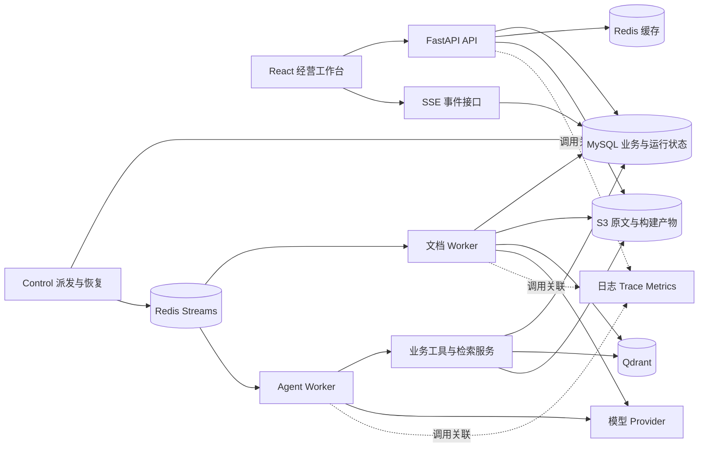

# SellerPilot v2 项目方案：业务后端与 AI 应用工程

设计修订：2.0；日期：2026-10-22。产品仍为 SellerPilot v2。

状态：待实施的目标方案。本轮重新规划，不核查当前代码完成率，不运行应用，不将旧文档中的实现或测试记录视为当前验证结果。本文所有验收指标都是预设目标，所有简历条目都是完成并取得证据后的表达模板。

本方案取代旧稿作为后续实施的规划基线；旧稿保留供追溯。此次不按工期裁剪目标，但按依赖关系分阶段交付。目标是形成能独立演示、解释设计取舍、复现故障并提供验证记录的业务项目。

## 1. 项目定位与最终交付

### 1.1 服务对象和需求来源

服务对象是管理一个或多个店铺的小型卖家。需求来源是家人尝试电商卖货的想法；目前不据此声称已有经营客户、真实订单流量或商业上线。

业务问题分为三类：商品和订单数据需要统一查询；规则、商品资料和经营经验难以与数据结合；模型建议与真正修改业务数据之间缺少可靠的执行流程。

项目定位：以 MySQL 中的店铺经营数据为事实依据，以版本化知识库提供规则证据，以受控 Agent 连接查询、解释和运营草稿，并通过人工确认完成可追踪的业务修改。

### 1.2 三条必须完成的业务流程

| 流程 | 具体任务 | 最终可展示结果 |
| --- | --- | --- |
| 经营分析 | 查询近七天分商品销售额，与上一周期比较，定位低库存商品 | 返回明确区间、币种、状态口径的事实卡片；查询结果可与 SQL 和手算样本核对 |
| 知识运营 | 上传标题规则和商品资料，询问型号、适用条件与例外条款 | 异步处理、分块预览、版本发布、引用原文；替换或禁用资料后后续查询使用正确范围 |
| 建议执行 | 根据指定商品事实和标题规则生成标题修改草稿，人工确认后应用 | 展示差异与依据；并发修改时拒绝覆盖；重复确认返回同一执行回执 |

经营变化与标题质量不能直接建立因果关系。没有曝光、点击、广告或成本数据时，不推断转化率、广告效果或利润。补货可以给出带假设的建议，不假装已经接入采购、供应商或电商平台执行接口。

### 1.3 面向实习的五条技术主线

| 技术主线 | 必须掌握的机制 | 对应证据 |
| --- | --- | --- |
| 数据库与查询性能 | 业务建模、统计口径、联合索引、执行计划、缓存与一致性 | 正确性样本、查询计划、负载与延迟对照 |
| 可靠后台任务 | outbox、至少一次投递、幂等、租约、恢复、取消 | 故障注入、任务状态与产物核验 |
| 知识检索工程 | 文档版本、分块、混合检索、重排、引用、评测 | 固定题集、消融对照、漏召回与错误引用分析 |
| Agent 服务工程 | 受约束查询、工具权限、执行预算、持久化事件、依赖故障 | 运行轨迹、端到端评测、耗时和模型用量 |
| 并发业务操作 | 审批、版本冲突、事务、幂等、审计 | 并发确认、过期草稿、超时重试实验 |

这五条均属于最终目标。账号、商品 CRUD、CSV 导入和基础页面是必要支撑，不作为简历的主要卖点。

## 2. 技术栈与选型决定

### 2.1 默认实施栈

默认沿用 Python 业务后端，面向后端开发与 AI 应用后端实习。没有明确 Java 岗位要求时，不同时建设两套业务后端。

| 层次 | 选择 | 职责与本人实现范围 |
| --- | --- | --- |
| HTTP 服务 | FastAPI、Pydantic | API 契约、输入验证、身份与店铺范围、错误码、异步任务受理 |
| 数据访问 | SQLAlchemy、Alembic、MySQL | 表结构、迁移、事务边界、查询编译、索引与并发控制 |
| 缓存与消息 | Redis 缓存实例、Redis Streams 队列实例 | 版本化缓存、限流；消息投递、消费与恢复；两实例隔离内存和淘汰策略 |
| 后台处理 | 同仓库 Python worker、control 进程 | 任务状态机、outbox 派发、租约回收、阶段产物与重试 |
| 原文和构建产物 | S3 兼容对象存储，默认验证 MinIO | 原始文件、解析结果、BM25 快照、构建清单；对象键不可由用户直接拼接 |
| 检索 | Qdrant、BM25 库、应用层 RRF、可选 reranker | 过滤范围、检索组合、证据对象、评测和默认策略选择 |
| Agent | AgentScope，保留简单 runner 作为对照基线 | 工具封装、业务工作流、预算、运行记录；不重复实现通用 Agent 框架 |
| 模型接入 | 一个 chat provider、一个 embedding 模型，按需增加 reranker | 超时、有限重试、并发限制、usage、实际模型版本和错误分类 |
| 交互 | React、TypeScript、Vite、SSE | 经营界面、知识中心、运行时间线、引用、审批和回执 |
| 观测与交付 | 结构化日志、OpenTelemetry、Prometheus/Grafana、Docker Compose、GitHub Actions | 调用关联、阶段耗时、故障定位、可复现部署、自动回归 |
| 验证 | pytest、真实 MySQL/Redis/Qdrant 集成测试、Playwright、k6 | 关键不变量、端到端流程、基础设施负载与故障实验 |

具体 Python、库、镜像和模型版本在兼容性探针通过后写入锁文件或镜像清单，不使用浮动 latest 作为验收环境。CPU/内存不足时观测组件通过 Compose profile 按需启动，不改变业务语义。

### 2.2 必须留下的选型记录

| 决策 | 可行备选 | 本方案决定与代价 | 何时重新考虑 |
| --- | --- | --- | --- |
| 应用形态 | 单进程、模块化单体、微服务 | 模块化单体，同一仓库和业务模型，API/worker/control 分进程；仍有进程间一致性成本 | 模块需要独立团队、独立发布或已有明确隔离瓶颈 |
| 队列 | MySQL 轮询、Celery、Redis Streams | Streams 配合 MySQL 状态；能观察消息与恢复机制，但必须自行承担状态机和运维 | 自行维护成本明显高于收益，或任务编排超出范围 |
| 检索引擎 | MySQL 全文、Qdrant、Elasticsearch/OpenSearch | Qdrant 管向量，BM25 管关键词快照；增加双路版本一致性成本 | 语料规模和复杂过滤已证明需要独立全文引擎 |
| 自然语言查数 | 固定工具、受约束查询、自由 Text-to-SQL | 固定工具加 QuerySpec 编译；支持范围明确，复杂自由查询能力受限 | 出现经过权限和成本评估的具体查询需求 |
| Agent 组织 | 固定流程、单 Agent、多 Agent | 统计请求直接执行；复合任务由单 Agent 调用工具，关键操作走确定性流程 | 对照实验证明专家拆分改善质量，且成本可接受 |
| 业务并发控制 | 分布式锁、数据库锁、版本更新 | MySQL 内使用短事务、行锁和条件更新；不以 Redis 锁替代数据库约束 | 需要协调不能归入同一数据库事务的具体资源 |
| 发布知识 | 直接覆盖、逐文档更新、不可变构建 | 不可变 build 加发布指针；发布安全但重建成本更高 | 测得全量构建成本不可接受，再设计增量版本 |
| 长连接 | 轮询、SSE、WebSocket | SSE 展示单向进度，普通 POST 承担操作；无需双向实时协议 | 业务确实需要实时双向协作 |

AgentScope 的工具、工作流和状态管理能力以官方文档为接口入口，具体模型兼容性仍由探针验证。[AgentScope 文档](https://doc.agentscope.io/)

### 2.3 Java 岗位的处理

本方案默认 Python，不宣称它能够证明 JVM、Java 并发或 Spring 能力。若后续明确将 Java 后端作为主要投递方向，再建立一个单独的架构决策：业务 API、事务、任务控制迁到 Spring Boot 与 MyBatis，AI 服务在确有依赖需要时保留 Python；一个领域仅保留一个写入权威服务。不能把加一个 Java 网关包装成掌握 Java 业务开发。切换语言不会替代本文要求的正确性、恢复和评测证据。

## 3. 总体架构与部署边界



一套代码仓库、一个业务后端应用，按职责启动 API、文档 worker、Agent worker、control。它们可以使用同一应用镜像的不同入口。MySQL、Redis、Qdrant 和对象存储各自作为基础设施容器；不运行 RAGFlow、Globex 或 ecommerce-agent 后端，也不要求第二个 Docker 引擎。

MySQL 是用户、商品、订单、任务、发布状态和动作结果的权威来源；Redis 不能决定动作是否已执行，Qdrant 不能决定资料是否授权。模型调用、文件解析、对象存储和向量写入都发生在业务数据库事务之外，提交状态时再开启短事务。事务边界参考 SQLAlchemy 的显式事务管理接口。[SQLAlchemy 事务文档](https://docs.sqlalchemy.org/en/20/orm/session_transaction.html)

## 4. 经营数据：准确查询与可解释的性能优化

### 4.1 业务模型与统计约定

最小领域为用户、店铺、成员、商品、订单、订单明细和数据接入批次。SKU 在店铺内唯一；外部订单号按店铺和来源唯一。订单明细保存成交单价及币种，不用商品当前价格回算历史销售额。

金额使用定点数或最小货币单位；不同币种分开统计。时间落库统一 UTC，业务日期由店铺时区转换为左闭右开区间。明确哪些订单状态计入销售额；若未建模退款，不将销售额写成净销售额。销售额变化比较两个可比区间，基期为零时展示绝对变化，不输出伪造增长率。

CSV 和受控 API 是首版接入方式，均经过同一业务服务。先保证去重、字段错误报告和事务语义；只有大文件负载证明必要时，再将导入接入通用任务流程。平台连接器可以后续真实接入，但不作为本文成立的前提。

### 4.2 QuerySpec 与 FactCard

QuerySpec 只允许指标、分组维度、时间区间、订单状态、排序和数量。不能包含 SQL、表名、任意表达式或模型指定的用户/店铺身份。服务端把白名单字段编译成参数化查询，限制查询区间、返回行数和可接受的计算成本。

优先支持销售额、订单数、销量、当前库存、两个区间的变化；拒绝未具备数据的利润和转化率。订单与明细 JOIN 的统计粒度分别设计，使用多明细订单样本防止订单金额和订单数被重复累计。

FactCard 保存 query_spec、tool_result_id、口径版本、数据版本、as_of、区间、币种、单位和结构化行。前端直接呈现经过确定性计算的数字。模型负责解释和建议，引用事实 ID；对自由文本中的经营数字做额外核对，不能声称加了 FactCard 后任何幻觉都被消除。

单次统计在短只读事务的一致视图中读取数据与版本。多工具运行不默认拥有跨分钟的数据库快照：每次结果标明 as_of 和版本；需要统一报告时，在模型调用前一次性查询并保存所需事实包。版本变化时复查或明确提示，不能混称同一时点。

### 4.3 索引与缓存实验

至少选择商品分页、订单过滤、分商品销售聚合三种真实访问模式，比较原查询、索引优化、必要的查询重写及缓存。索引候选包含店铺、状态、时间、关联键，最终顺序由过滤分布和执行计划决定，不固定背诵最左前缀。

商品和订单列表默认稳定排序与游标分页；跨商品聚合的全局排名仍需计算，不声称游标能够消除聚合成本。若引入日聚合表，必须记录维护成本、数据新鲜度及与原始订单重算的核对结果，不能只展示查询变快。

经营统计缓存键包含 store_id、data_version、规范化 QuerySpec 和口径版本。数据写入和版本递增在同一事务；先取得版本，在同一快照查询并确认版本一致后才填入该版本缓存。版本在生成报告中变化时不得把旧结果写进新版本的 key。TTL 用于回收旧 key，不能独自承担正确性。

按店铺递增版本会让该店铺写请求竞争同一行：这是首版一致性与吞吐之间的取舍，须在写负载实验中观察。达到瓶颈后再按数据域拆分版本，而不是直接宣称可支撑高并发。

验收：手算样本完全一致；变更后新请求不读取旧版本统计；Redis 不可用时受控回源；保存 EXPLAIN ANALYZE、数据分布、冷暖缓存、并发、错误率、p50/p95 和资源使用。

## 5. 店铺权限与团队协作

以店铺为租户边界，一个用户可属于多个店铺。角色先设 owner、operator、viewer；权限映射到读经营数据、维护商品、管理知识、确认动作、管理成员等能力，具体授权矩阵随 API 一起验收。

统一构造 AuthContext/RunContext：user_id、store_id、membership/access_version、run_id、允许工具及能力。模型只提供业务参数，不能决定身份范围。API、工具、任务查询、文件下载和 SSE 使用同一权限服务。向量检索带店铺与构建过滤，返回后再核验来源，缓存不能绕过授权。

后台任务开始、工具调用、动作确认和新的事件读取时重新检查授权。成员撤权后阻止新访问；正在传输或已经进入模型上下文的数据无法凭版本号撤回，对在途运行执行取消和后续输出拦截，并明确这一边界。JWT 身份有效不意味着店铺权限仍有效。

验收覆盖同 SKU 跨店铺、伪造路径 store_id、任意对象 ID、越权引用、文件 URL、缓存命中、运行重连和排队后撤权。权限用例单独报告，不混在普通检索召回率中。

## 6. 可靠异步任务与事件流

### 6.1 任务状态和可靠投递

文档构建与 Agent 运行使用一套任务合同，按 task_type 路由到两个 Stream；不并行维护 Celery 和另一套消息队列。

状态为 queued、running、retry_wait、succeeded、failed、cancelled；另保存 attempt、next_retry_at、lease_until、fencing_token、cancel_requested、错误分类和产物引用。任务终态和历史尝试保留，人工重试创建可追溯的新尝试。

1. API 在同一 MySQL 事务创建 job 和 outbox，提交后返回任务 ID；Redis 暂时不可用仍可受理到数据库。
2. Control 短事务以带过期时间的派发租约领取 outbox，事务外 XADD；确认投递后再更新 outbox。派发者退出后租约可回收；XADD 成功但确认状态前退出允许重复投递。
3. Worker 取得消息后以数据库条件更新领取 job，递增 fencing_token 并设租约。每条消息只是执行提示，不代表独占任务资格。
4. 执行期间续租；产物按 job/attempt/token 隔离。提交进度、事件和最终结果时检查当前 token、有效租约和任务状态。
5. 成功结果与任务终态落库后 ACK。若终态已存在，重复消息只确认，不再次提交业务效果。
6. 可重试错误先持久化 retry_wait 和下一次执行时间，再 ACK 原消息；Control 到期重新派发。不可重试错误进入 failed，保存诊断信息。

消息认领使用 XAUTOCLAIM 周期扫描 pending，但它只转移消息所有权，不能替代数据库租约与业务幂等。Control 的实际入口必须执行回收逻辑。[Redis XAUTOCLAIM 文档](https://redis.io/docs/latest/commands/xautoclaim/)

Outbox 批量领取可用 FOR UPDATE SKIP LOCKED，限定在队列式工作分配，不用于需要完整视图的经营统计。[MySQL 锁定读取文档](https://dev.mysql.com/doc/refman/8.4/en/innodb-locking-reads.html)

### 6.2 失效 Worker、Redis 丢消息和外部副作用

租约过期后可由新 Worker 接管，旧 Worker 恢复时因 token 过期无法提交。Qdrant 和对象存储写入按尝试隔离，只有有效尝试可在 MySQL 发布产物；旧尝试可能留下垃圾，但不能覆盖当前发布内容。

Redis 队列启用持久化与 noeviction，同时以 MySQL 任务表对账：超过阈值未启动、租约过期或已失去消息的未完成任务可以重新投递。因此队列不是恢复任务所需的唯一证据。回收存在时间窗口，不宣称立即恢复或永不重复。

外部模型调用可能已成功但本地未收到响应，重试可能再次计费；不承诺 exactly-once。文档产物与数据库写入按业务幂等控制，实际运营动作由独立确认事务执行，后台 Agent 不自动重放写动作。

### 6.3 重试、取消与资源隔离

网络超时、服务端限流按有上限的退避与抖动重试；权限错误、参数错误、损坏文件不盲重试。用户取消通过 cancel_requested 在阶段边界生效；外部请求未必可立即取消，结果返回后不得发布已取消任务的产物。

设置文档和 Agent 独立并发池、每店铺待执行任务上限、模型调用限额和总队列上限。初版不宣称严格公平调度；使用大店铺持续提交与小店铺间歇提交实验，记录等待分布。若持续出现饥饿，再实现按店铺轮转派发并对比，不能仅凭总并发限制声称公平。

### 6.4 持久化 SSE 与运行中断

run_events 使用 run_id、attempt_id、seq 标识事件，唯一约束控制序号；先提交事件，再供 SSE 读取。Redis 通知只能加速唤醒，断线恢复从 MySQL 按游标补读；事件定期清理，过期游标返回明确结果和最终快照。

流展示受理、排队、工具开始/结束、已验证事实、答案增量与终态。正文增量批量落库，未持久化文本不发送；前端按事件 ID 去重。模型自由文本流标注为生成中，最终答案经过引用和结构检查后再标记完成。

SSE 连接断开不创建第二个任务；重连只订阅同一 run。已输出部分答案的 Agent Worker 崩溃后，旧 attempt 标记 interrupted，保留已发事件；人工重试产生新 attempt，不把两次随机生成的文本拼接为一次答案。文档任务则可从有效阶段产物恢复或幂等重做。

前端若使用 Bearer JWT，采用可设置 Authorization 的 fetch 流式客户端并实现游标重连；不把长期 JWT 放进 URL。原生 EventSource 与 fetch 的重连行为不能混为一谈。[MDN SSE 文档](https://developer.mozilla.org/en-US/docs/Web/API/Server-sent_events/Using_server-sent_events)

验收覆盖断线补读、重复事件、任务终态、事件清理、撤权和服务重启；心跳或排队事件不计作首个答案内容。

## 7. 知识管理与检索效果

### 7.1 自行实现的文档流水线

流程为上传、保存原文、创建版本、解析、清洗、分块、预览、向量化、建立双路索引、校验、发布。支持 TXT、Markdown、DOCX 和可提取文本的 PDF；所用解析库通过样本确定，不自行开发通用解析器。

扫描 PDF、复杂表格和图片理解列为明确的后续业务扩展；未实现时应检测并提示，不返回空文本却显示处理成功。分块优先保留标题、条款编号、型号、适用范围和例外条件；为每块保留文档版本、页码或章节、原文偏移和父片段引用。

固定长度分块是对照基线；最终比较标题/段落感知分块与必要的父子片段补充。应用层实现版本、流程和检索组合；BM25、embedding、数据库和解析器使用成熟实现，不包装成自研算法。

### 7.2 不可变构建与发布

每个 build manifest 固定文档版本集合、解析/分块配置、embedding 模型、BM25 快照和向量命名空间。只在构建产物完整、双路索引样本可查且当前 worker token 有效时，通过 MySQL 短事务切换 active_build_id。

发布使用知识库 revision 条件更新；资料增删、替换、禁用与发布均维护相应 revision。若构建期间资料清单或发布版本已变化，旧构建不得覆盖新清单，重新排队构建。一次检索先固定 build，关键词和向量均使用该构建；不能一条路查新版本、一条路查旧版本。

初版允许每个知识库全量构建，复用已完成的解析和 embedding 产物；发布安全优先于未经验证的增量索引。向量模型维度变化创建新 collection 或模型代际，不混写。

禁用/删除先在 MySQL 标记不可见并递增 visibility_version，后续检索和缓存结果在送入模型前重新过滤；旧向量和对象异步清理。保留版本仅供授权审计，不再参与当前问答。在途数据的撤回边界遵循第 5 节。

验收：半成品构建不发布；构建失败保留旧版本；并发替换不丢修改；禁用后新的查询与缓存命中不暴露禁用内容；清理失败不会导致重新可见。

### 7.3 检索链与默认策略

检索依次完成查询规范化、权限与 build 固定、BM25/向量召回、去重、RRF、按需重排、父片段补充、来源复核和证据返回。BM25 的中文切词、型号分词与大小写处理都是配置的一部分，不能只调向量模型。

RRF 按名次融合，避免直接相加不同量纲的原始分数；本项目在应用层实现，以支持外部 BM25 快照。参数和名次起点显式记录，不依赖数据库版本的默认值。[Qdrant 混合查询与融合说明](https://qdrant.tech/documentation/search/hybrid-queries/)

必须实现并比较 BM25、向量、混合、混合加重排四种配置。在开发集选择参数和默认策略，冻结后用保留测试集报告效果、延迟和成本；不反复根据保留集调参，修改后需要新的保留样本。交付对照实验不等于保证复杂方案必然更好。未配置或调用失败时明确记录 rerank_applied=false。

不得把 RRF 分数当作经过校准的回答置信度。无答案判断结合相关性阈值、证据覆盖和专门的无答案题集。Qdrant/embedding 故障时可降级到同 build 的 BM25，必须记录降级；没有授权范围内的有效证据时提示无法回答。

### 7.4 引用与来源

Evidence 包含 chunk_id、document_version_id、build_id、来源位置、原文片段及检索配置。回答保存 claim 与 evidence_ids 的关联，来源页面能打开对应版本和原文位置。

服务端检查引用 ID、权限、版本和可见性；这些结构检查不等于语义受支持。逐结论支持率通过人工标注与辅助评审评测。资料互相矛盾时展示冲突、适用日期和范围，不能让模型任意选一个当作权威。

检索缓存键含店铺、build、visibility_version、授权范围、query、filter 和检索配置。缓存只复用候选结果，交付前仍核验权限与可见性。embedding 缓存含模型、输入规范化版本、内容哈希和租户范围，避免跨店铺数据侧漏。

## 8. Agent 问答与经营分析

### 8.1 三种执行路径

| 请求 | 执行方式 | 选用理由 |
| --- | --- | --- |
| 点击经营报表、明确结构化查询 | 确定性业务服务 | 结果直接可算，无需模型增加延迟和随机性 |
| 自然语言查数或规则问答 | 单 Agent 与受控工具 | 需要理解表达、选择工具和整合证据 |
| 经营事实与规则结合生成草稿 | 有界组合流程 | 可并行读取独立数据，校验完整性后生成草稿，审批执行独立进行 |

不要求每轮启动 Analyst、Knowledge、Planner 等多个角色。保留一个单 Agent 基线；若开展多 Agent 实验，使用同一题集比较完成率、重复调用、成本和延迟，只有收益明确的任务进入默认路由。

### 8.2 工具与运行合同

首批工具为 query_store_metrics、get_product、list_low_stock、search_knowledge、get_evidence、create_title_proposal。工具参数经 Pydantic 验证，服务端注入身份范围；写草稿也检查权限和幂等键。确认应用接口不暴露给模型。

运行记录 user/store、问题、上下文版本、数据与知识快照、工具目录版本、Prompt、模型、预算和实际降级。工具调用保存参数摘要、结果引用、耗时和错误码；敏感内容按权限脱敏，不能直接将内部轨迹全部展示给用户。

为每次运行设置最大工具调用数、模型调用数、总时长、上下文和 Token 预算。具体值通过题集确定。独立读取可有限并行；相同失败工具不得无意义循环。进程内 semaphore 只限制本进程，多 worker 的 provider 并发需要独立的原子限额。

工具结果与文档内容作为外部数据处理，文档中的指令不得改变系统权限、工具目录或执行边界。恶意资料、伪造工具结果和指代含混的问题纳入评测。

### 8.3 模型故障与会话状态

模型网关统一超时、短暂故障重试、熔断、usage 与 provider 错误。已输出部分流时不静默切模型并拼接，明确结束该 attempt。usage 缺失标为缺失，估算成本与供应商实计分开显示。

会话持久化，设置上下文窗口与摘要版本；经营事实默认重新查询，不将旧回答作为当前库存。首版不建设跨用户长期记忆平台。单会话同一时刻只允许一个活跃 run，或在提交时用会话版本拒绝冲突，避免两次运行交错改写历史。

验收同时评价最终结果和过程：业务参数正确、任务覆盖、证据支持、调用预算、重复工具次数、费用和响应分段耗时。最终答对但跨店铺取数或超预算仍判失败。

## 9. 运营草稿、审批与并发一致性

### 9.1 动作范围与状态

最终版本必须完整支持 update_product_title 这一种实际动作。补货计划和其他经营建议可以生成，不直接执行库存或采购变更；后续新增动作逐个增加确定性执行函数与验收。

草稿保存目标商品、原值、新值、product_version、payload_hash、事实/知识依据、创建者、状态和有效期。状态为 pending、applied、rejected、conflicted、expired；确认并应用本地标题属于一个数据库事务，无需人为拆成异步审批平台。草稿编辑生成新修订并重新确认。

### 9.2 确认事务

客户端提交 proposal_id、payload_hash 与幂等键。服务端固定锁顺序，短事务锁定草稿与商品，检查当前成员权限、状态、有效期、版本及载荷。产品更新、product_version 和 store data_version 递增、execution receipt、audit log 与 outbox 在同一事务提交。死锁或锁超时需回滚完整事务，按同一幂等请求有限重试，不能复用已失效的事务状态。

执行记录以 proposal_id 唯一，幂等键按店铺/动作限定。重复确认已 applied 草稿返回原回执；同幂等键不同载荷返回冲突。校验失败保存或返回明确冲突，不自动覆盖新数据，不根据模型声称“用户已同意”执行。

所有商品写路径均递增 product_version。只比较原始标题无法发现 A→B→A 的中间修改，版本检查需覆盖该用例。乐观锁不能替代动作状态和幂等约束，二者分别解决过期写入与重复请求。

多商品批量确认逐项生成结果与回执，允许部分冲突，不宣称全批原子成功。未来真正接入平台写 API 时，必须另行处理外部超时、结果未知和对账；本地 MySQL 事务不能保证远程平台恰好执行一次。

验收：同时确认同一草稿、同商品两份草稿竞争、A→B→A、用户撤权、过期、提交成功但响应丢失后重试、同 key 不同载荷。核对商品最终值、版本、执行记录和审计记录数量。

## 10. 可观测性、限流与交付工程

API、队列、worker、工具与模型通过 request_id/run_id/job_id/attempt_id 关联，并传递 trace 上下文。日志记录阶段、耗时、token、错误码与版本，默认不记录密钥、完整原文或个人数据。OpenTelemetry 负责跨组件追踪，应用仍需显式定义关键业务 span。[OpenTelemetry Python 文档](https://opentelemetry.io/docs/languages/python/)

Prometheus/Grafana 至少展示 API 错误与延迟、队列深度与等待、处理耗时、重试与失败、租约接管、检索降级、模型超时和并发、Token 用量及缓存命中。run_id、用户 ID 等高基数字段只放日志或 trace，不作为无界指标标签。

请求限流、任务数量限制和 provider 并发分开处理。外部依赖故障时排队上限防止无限堆积；缓存故障受控回源；队列故障不改为 API 内偷偷执行重任务；鉴权故障不降级放行。

CI 包括静态检查、关键单元测试、真实 MySQL 事务与 Redis 队列集成测试、前端构建及一条端到端主流程。LLM 真实调用评测手动或受预算触发，不把付费和随机网络结果塞入每次提交的基础门禁。锁和隔离级别相关测试不能仅由 SQLite 替代。

交付要求包含依赖锁、环境变量示例、迁移、初始演示数据、健康检查和空环境启动文档。数据库和对象存储备份、恢复与构建产物清理各演练一次；恢复后核对文档、发布版本与索引引用。单机 Compose 部署不写成高可用集群。

## 11. 数据模型、接口与代码边界

### 11.1 主要实体与约束

| 领域 | 主要实体 | 核心约束 |
| --- | --- | --- |
| 身份与店铺 | users、stores、store_memberships | 用户/店铺成员唯一；角色及访问版本明确 |
| 商品与订单 | products、orders、order_items、import_batches | store/SKU 唯一；外部订单去重；金额口径与版本更新 |
| 知识资料 | knowledge_bases、documents、document_versions、knowledge_chunks | 不可变原文版本；来源位置；删除可见性独立于物理清理 |
| 构建 | index_builds、build_documents | manifest 固定输入；active pointer 与 revision 条件发布 |
| 后台任务 | jobs、job_attempts、outbox_events | 任务幂等键；领取 token；重试时间和终态 |
| 对话与运行 | conversations、messages、agent_runs、run_events | 会话版本；run/attempt/seq 唯一；输出与状态可追溯 |
| 动作 | action_proposals、action_executions、audit_logs | proposal 执行唯一；载荷、目标版本及同事务审计 |

不按表的数量衡量规模。能用清晰字段表达的状态不额外建通用工作流引擎；运行费用先用运行和尝试记录汇总，不建设订阅计费账本。

### 11.2 主要 API 合同

| API 族 | 代表接口 | 关键语义 |
| --- | --- | --- |
| 经营查询 | POST /api/v2/stores/{sid}/metrics/query | 受约束 QuerySpec；返回 FactCard 和口径 |
| 知识资料 | POST /api/v2/stores/{sid}/documents | 上传生成版本与 job；不把处理成功等同于接收成功 |
| 构建与检索 | POST .../knowledge-bases/{kid}/builds；POST .../retrieval-tests | 构建发布与策略测试；参数和实际执行策略均记录 |
| Agent 运行 | POST .../runs；GET .../runs/{rid} | 幂等受理；状态、最终结果与尝试信息分开 |
| 事件流 | GET .../runs/{rid}/events | 带游标、授权和保留期语义的 SSE |
| 任务管理 | GET .../jobs/{jid}；POST .../jobs/{jid}/cancel | 可查询、可取消；不能保证外部调用立即停止 |
| 草稿审批 | POST .../proposals；POST .../proposals/{pid}/confirm | 绑定载荷和商品版本；幂等回执与冲突 |

省略号均代表 /api/v2/stores/{sid}，是拟定合同，不是已存在路由。错误码区分未授权、资源不可见、版本冲突、额度不足、依赖失败和无有效证据，不返回一律成功加字符串错误。

### 11.3 代码组织目标

```text
backend/
  app/
    api/              # 路由与响应合同
    auth/             # 成员与能力校验
    commerce/         # 商品、订单、统计、QuerySpec、FactCard
    knowledge/        # 文件、版本、解析、分块、构建与发布
    retrieval/        # BM25、向量、融合、重排、证据
    agent/            # Runner、工具适配、预算、会话
    actions/          # 草稿、确认、执行与审计
    jobs/             # 状态机、outbox、租约与恢复
    infrastructure/   # DB、Redis、对象存储、模型、观测
  workers/            # 文档/Agent/control 入口
  migrations/
  tests/
frontend/
evals/
  datasets/
  runners/
  reports/
experiments/
docs/
  adr/
  failure-cases/
  architecture/
deploy/
```

这些是实施后的目录目标。领域服务不依赖 HTTP 请求对象；API、工具和 worker 共用业务校验，避免各写一套规则。

## 12. 按依赖推进的交付阶段

以下没有时间承诺，各阶段完成后必须留下可演示增量；所有阶段共同构成目标版本。

| 阶段 | 建设内容 | 退出条件与产物 |
| --- | --- | --- |
| M0 基线与兼容性 | 盘点实际代码；冻结回归与演示样本；测试模型/AgentScope、Redis、Qdrant、对象存储 | 当前能力矩阵；依赖锁；端到端最小探针；不把本方案写成已完成 |
| M1 数据与权限 | 店铺成员、SKU 范围、价格快照、统计口径、版本、QuerySpec 和 FactCard | 手算与 SQL 一致；所有读写通过店铺权限；迁移数据可核对 |
| M2 数据库性能 | 真实查询、索引、分页、缓存、写版本竞争实验 | 正确性不退化；冷暖查询计划和性能报告；有无缓存对照 |
| M3 后台任务 | jobs/outbox、Streams、worker、租约、重试、对账、取消与 SSE | 文档占位任务和真实 Agent 调用可跟踪；杀进程、重复消息和断线恢复通过 |
| M4 知识生命周期 | 上传、解析、分块预览、构建、发布、禁用、引用定位 | 用自己上传的资料真实回答；失败不发布；双路版本与可见性正确 |
| M5 检索效果 | 四策略、分块实验、无答案与冲突、题集和缓存 | 冻结对照报告；默认策略由实测决定；权限题单独通过 |
| M6 Agent 与业务动作 | 组合分析、预算、模型故障、会话版本、草稿确认与审计 | 一条真实复合任务；并发/重试不重复修改；失败轨迹可解释 |
| M7 交付与证据冻结 | 观测、CI、空环境部署、备份恢复、完整评测和录屏 | 冻结提交、环境、数据、结果与局限；形成面向岗位的简历选材 |

M3 可以先接简单任务与原 runner，不能等知识中心和所有框架迁移完成才演示任务链。性能、评测题和故障记录从对应模块第一版开始积累，M7 只冻结和复核，不临时补造过程。

## 13. 验证方案与可量化目标

### 13.1 数据与问题集

经营正确性使用小型手算样本，包括多明细订单、取消状态、不同币种、零基期、跨时区边界和同 SKU 跨店铺。性能另生成小/中/大三个档位的订单与明细数据；最高档以 100 万订单为实验目标，受资源限制时如实报告实际规模，不能把合成数据写成真实订单。模拟性能瓶颈用于研究系统边界，不作为家人已经遇到大规模业务问题的证据。

知识资料目标为 30–100 份有实际内容的规则、手册或自编业务资料，人工检查解析质量；标记真实来源、获取日期、自编与合成身份，不能把自编规则冒充平台官方政策。数量是覆盖需求的参考，不为凑片段数切碎资料。

检索与引用题集目标 150 题，开发集 100、保留测试集 50；按文档主题/模板族划分，避免同义改写跨集合泄漏。六类覆盖：精确词面 30、语义改写 30、多条件/例外 20、版本/冲突 20、无答案 25、跨店铺与权限 25。权限题以是否泄漏单独计分，不参加普通 Recall。

另建 40–60 个 Agent 场景，包含单工具、复合任务、澄清、无答案、恶意资料、参数错误、依赖故障与动作草稿；关键场景重复运行，报告波动。LLM 辅助生成的题目和参考答案必须人工复核，人工评分保留规则与争议样例。

### 13.2 指标与门禁

| 维度 | 指标或不变量 | 目标性质 |
| --- | --- | --- |
| 业务准确性 | 金额、订单数、币种、区间与手算基准一致 | 必须通过的确定性门禁 |
| 权限与版本 | 越权读取、过期写入、禁用资料新查询泄漏 | 列出的固定用例全部通过；不外推为任意输入零风险 |
| 执行动作 | 一个 proposal 只产生一次有效数据库修改 | 所有重复/并发/超时重试用例通过 |
| 任务恢复 | 不丢已提交任务，旧 token 不发布，终态可查 | 故障矩阵通过，记录恢复时长和重复尝试 |
| 检索 | Recall@5、MRR/nDCG、分类型漏召回 | 同题集对照；目标 Recall@5 ≥ 0.85，未达到时报告原因与范围 |
| 引用与无答案 | 逐结论支持率、错误作答率、拒答精确率/召回率 | 人工支持率目标 ≥ 0.90；不能用一律拒答提高表面可靠性 |
| Agent | 任务成功率、QuerySpec 字段正确率、预算违规、重复调用 | 固定集目标成功率 ≥ 0.85，关键确定性约束不得违反 |
| 查询性能 | p50/p95、吞吐、错误率、扫描行数、资源 | 不预先编造倍数；同环境与相同结果语义对照 |
| 端到端体验 | 受理、排队、工具、首个事实/正文、最终完成与成本 | 分段报告，不把心跳当首字，不把 Mock 当真实模型 |

上述数值是内部验收目标，不是招聘门槛或已测结果。样本较小时同时报告分子/分母与失败分布，不能只报百分比。若新方案没有改善，就记录负结果并选择更合适的默认方案。

### 13.3 三层实验分离

1. 纯算法/服务层：比较分块、召回、重排、QuerySpec 和提示词，尽量固定其他变量。
2. 真实端到端：浏览器/HTTP、队列、worker、真实模型和 SSE，记录排队与外部依赖耗时。
3. Mock 负载与故障：固定模型延迟/错误，定位基础设施吞吐、资源和恢复；报告明确标注 Mock。

每份报告记录代码提交、机器与容器资源、依赖与模型、Prompt、数据与题集版本、参数、随机性、实际策略/降级、缓存状态和原始结果。冷启动、热缓存、单并发和多并发分别报告；固定请求量与到达率，避免只看幸存请求的低延迟。

### 13.4 必须执行的故障矩阵

| 编号 | 故障注入或反例 | 应有行为 | 核验对象 |
| --- | --- | --- | --- |
| F01 | DB 提交 job 后、XADD 前退出 | outbox 后续补发 | job、outbox、worker 日志 |
| F02 | XADD 成功、outbox 标记前退出 | 可重复投递，不重复提交结果 | 消息 ID、尝试、业务产物 |
| F03 | Worker 领取后退出 | 租约到期可恢复 | token、接管时间、终态 |
| F04 | 旧 Worker 暂停后恢复，与新 Worker 竞争 | 旧 token 无法提交或发布 | 条件更新结果、发布指针 |
| F05 | Redis 重启/消息丢失 | DB 对账重新投递未完成任务 | 任务清单与实际完成记录 |
| F06 | 构建只写完一部分向量后失败 | 旧 build 继续服务，半成品不可见 | manifest、active build、检索来源 |
| F07 | 构建期间另一次资料替换并发布 | revision 冲突，不丢新修改 | 构建输入与发布记录 |
| F08 | 禁用资料但命中旧缓存 | 新调用过滤禁用片段 | visibility_version、候选与最终证据 |
| F09 | 商品发生 A→B→A，确认旧草稿 | product_version 冲突 | 版本、最终标题与回执 |
| F10 | 并发确认、DB 成功后客户端超时重试 | 一次有效修改，返回原回执 | 商品、execution、audit 数量 |
| F11 | 排队后撤权、越权订阅事件 | 不再开始授权操作，新的读取被拒绝 | 授权版本、取消和事件访问 |
| F12 | 模型超时、限流、部分输出后崩溃 | 有限重试或 interrupted，不拼接两次答案 | attempt、事件、调用次数和成本 |
| F13 | SSE 断线、重复游标或过期游标 | 补读去重，过期返回快照/明确错误 | seq、前端内容、最终状态 |
| F14 | 缓存失效、数据库资源吃紧 | 受控回源与限流，不能无限放大压力 | 错误率、连接池、队列与延迟 |

这是计划执行的实验，不是已经发生的线上事故。不得为满足“失败后解决”而编造故障历史；合理的基线局限、真实开发 bug 和受控故障都可以成为材料，但要准确标注来源。

## 14. 从实现到可书写的个人证据

### 14.1 每条技术主线维护一个证据包

每个证据包保留业务问题、初版基线、备选方案、决策记录、关键代码入口、失败或反例、修复提交、同条件复测、结果和限制。记录本人承担的设计与实现，区分框架、库、参考项目及 AI 辅助内容。

建议固定五个主题：经营查询优化、队列崩溃恢复、资料版本与检索效果、Agent 错误定位、草稿并发执行。不要求每个主题都有戏剧性的 bug；如果选择更简单方案，也应保留证据。

决策记录模板：问题与约束；备选；选择；为什么承担这些代价；验证；什么条件下改变决定。失败记录模板：环境与版本；输入；预期/实际；最小复现；日志与根因；修复；同用例复测；剩余边界。

禁止先写“优化 80%”再寻找数据。数值先来自冻结报告，简历再选材；本地实验写清环境，用户验证写明样本与任务，不能转写成生产收益。

### 14.2 完成后的简历介绍方向

项目介绍只占一到两句，随后按岗位选择三到四项贡献。以下为待完成模板，不可直接当作已完成经历投递：

> SellerPilot｜面向小型电商卖家的经营管理与智能运营系统。针对经营数据与规则资料分离、通用模型缺少店铺事实及运营建议难以可靠落地的问题，建设结构化经营查询、版本化知识检索与人工确认执行流程。

后端岗位优先展示数据库、异步任务和并发操作；AI 应用后端优先展示检索、工具服务与运行治理。项目没有真实上线时，标为个人项目/原型，需求来源与实际使用人数分别表述。

### 14.3 问题驱动的贡献条目

- **任务可靠性**：针对文档解析与向量化耗时长、进程中断导致任务处理不完整的问题，设计 MySQL job/outbox 与 Redis Streams 协作流程，通过幂等消费、租约及 fencing token 控制恢复与提交，并通过消费者退出、重复消息和队列恢复实验验证。
- **并发一致性**：针对运营草稿生成后商品已变化、重复确认可能重复执行的问题，设计绑定商品版本和载荷的确认事务，将商品修改、执行回执与审计同事务提交，验证并发确认、A→B→A 和超时重试的行为。
- **检索效果**：针对型号精确匹配、规则语义改写及例外条件查询并存的问题，对比分块、BM25、向量、RRF 与重排方案，建设版本化来源引用和无答案评测，以冻结报告说明默认策略的质量、延迟与成本取舍。
- **查询性能**：针对经营分析中多表聚合与重复查询的问题，统一统计口径和受约束 QuerySpec，结合执行计划调整索引与查询，采用数据版本缓存并验证失效与回源；具体性能变化从同环境报告填入。
- **Agent 工程**：针对经营问答缺少实时数据且工具调用范围与开销难以控制的问题，将业务查询和知识检索封装为受控工具，加入店铺授权、参数验证、执行预算与持久化事件，依据运行轨迹定位失败并报告任务成功率和调用成本。

简历不必同时塞入五条，也不罗列所有基础设施。每条能定位到代码和实验，才能经得起追问；没有量化改善时写可验证的正确性与恢复行为。

### 14.4 面试准备的成果要求

为上述五个主题各准备一次三分钟解释：业务触发、最简单基线、为什么不足、备选与取舍、关键状态/事务、失败证据、结果和局限。另能根据问题画出一次请求的数据流，以及 Worker 崩溃或重复确认时的状态变化。

重点理解自己的关键代码：查询编译与 JOIN 粒度、版本与缓存填充、outbox 重复投递、租约失效提交、build 发布、引用校验、动作确认事务。讲不清的组件不能只靠技术栈名称占据简历。

## 15. 与参考项目和第二个轮子项目的关系

RAGFlow 用作知识生命周期、解析分块、检索测试与来源展示的设计参考；Globex 用作 Agent 与任务服务拆分的参考；ecommerce-agent 用作事实呈现、任务事件和评测边界的参考；DOVideo-AI 用作完整后台处理流程与故障恢复的比较对象。这里承接历史讨论，不代表本轮重新核查了这些仓库，也不据此声称其当前代码具备特定能力。

SellerPilot 自己实现应用层领域模型、权限、流水线、发布、检索组合、任务状态与业务执行。使用组件是正常工程实践，不要求重写向量数据库、解析器或 Agent 框架；如实际复制代码，应遵守许可证并记录来源，不能改名后称完全原创。

第二个轮子项目负责通用能力，例如 Coding Agent 的工具协议、执行循环、沙箱、上下文压缩、checkpoint、取消和 benchmark。SellerPilot 负责业务真实性、数据正确性、权限、知识证据和执行可靠性。两者先独立完成，确有复用后再抽公共接口；不为 SellerPilot 再建设通用 Agent 平台、可视化编排器或任意插件市场。

以下能力不属于本版成立的必要条件：支付/购物车、供应链、分库分表、跨区域高可用、Kubernetes、全链路分布式事务、多 MQ、四角色强制协作、自动采购、订阅计费、通用长记忆和自由 Text-to-SQL。以后增加必须说明具体业务需求和新的验收，时间充足也不自动增加。

## 16. 最终完成定义

目标版本只有在下列条件全部满足时，才标记为完成：三条业务流程真实跑通；五条技术主线有代码和证据；核心权限、金额、版本及幂等用例通过；故障矩阵有执行记录；检索和 Agent 有冻结题集与真实模型结果；CI 与空环境部署可复现；备份恢复已演练；简历条目均能对应个人贡献、代码和结果；限制与未覆盖场景明确公开。

交付包包含架构与数据流图、部署与迁移说明、演示数据、三段业务录屏、关键 ADR、五个主题证据包、评测原始数据与报告、故障恢复记录、版本清单和简历选材。文档完成只表示方案可实施，不表示这些工程目标已完成。
