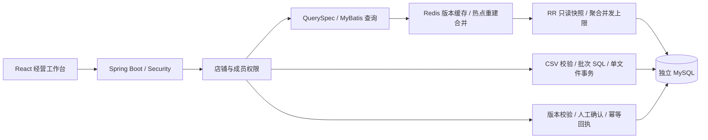

# SellerPilot Java 改造实施记录

本次将 SellerPilot 的业务主线迁移到独立 Java 模块，面向“订单事实可核对、重复经营查询可承受、并发审批不重复生效”三个问题。Python 原实现作为独立参考保留；没有把 Python RAG、Agent 和任务队列全部重写成 Java。

## 已实现的链路

Java 21、Spring Boot 4.0.9、MyBatis 4.0.0、MySQL 8.4、Redis 7.4、Flyway、HikariCP、Micrometer、JUnit 和 k6；前端增加显式 Java 模式。运行和接口边界见 [模块说明](../backend-java/README.md)。

| 问题 | 实现 | 验证方式 |
| --- | --- | --- |
| 一个订单多条明细导致重复计数，退款/币种/时区口径混乱 | 白名单 QuerySpec、绑定参数、UTC 半开区间、distinct 订单、独立币种、成交/退款/净额 | 手算样本 40.00−2.00=38.00、两明细仍为一订单、上边界与多币种用例 |
| 旧快照可能回填到新版本，重复查询持续聚合大表 | 写入与版本同事务；版本与结果同 RR 快照；版本键缓存 | RR/RC 对照、晚到旧请求不污染新键、写后查询看到新版本 |
| 多人确认覆盖新商品或重复执行 | 固定锁序、商品版本、payload hash、唯一回执、幂等键、同事务审计 | 100 客户端同时确认、ABA、同键不同草稿、提交后重复请求、审计故障回滚 |
| 重复上传或半个文件入库 | 文件哈希去重、店铺业务键 upsert、500 行批次、单文件事务 | 重复文件/业务键更新、501 行第二批故障后首批与版本一并回滚 |
| 跨店铺读取或撤权后继续访问 | 服务端身份与店铺授权；缓存命中也先读取权限/版本 | 跨店铺 404、未认证 401、同 JWT 撤权立即失去后续访问 |

完整本地 Maven 验证为 **18 项通过，0 失败、0 错误、0 跳过**，其中 13 项连接真实 MySQL/Redis，5 项为参数与解析测试。原始结果归档在 [JUnit 目录](verification/java/junit)。浏览器链路独立验证注册、建店、商品、订单/明细上传、38.00 结果、审批和审计，报告见 [browser-results.json](verification/java/browser-results.json)。

## 数据与性能实验

使用固定 seed=42 在独立 Java MySQL 库生成 **1,000,000 条模拟订单、2,499,285 条明细**；三个店铺分别有 800,053／149,719／50,228 条订单。生成耗时约 120.4 秒，造数直接写入数据库，**不是导入接口吞吐**。详见 [seed-manifest.json](verification/java/seed-manifest.json)。

固定查询热点店铺最近 7 天、paid/shipped、按商品与币种聚合、limit=20；SQL、EXPLAIN 与负载读取同一 QuerySpec。J0/J1 每秒 2 请求、30 秒；缓存阶段另执行每秒 200 请求、5 分钟。每次负载先登录并预热，测量阶段单独打标签；业务错误包含非 200 和返回值不一致，拒绝请求也计入失败。

已取得的原始 k6 结果如下，延迟只取 `phase:measured`，失败响应仍计入：

| 阶段 | 负载 | 测量请求数 | p95 | 业务失败 | dropped | 结论 |
| --- | --- | ---: | ---: | ---: | ---: | --- |
| J0 原索引、无缓存 | 2 req/s，30s | 61 | 约 4.96s | 49/61 | 0 | 未达标 |
| J1 修正覆盖索引、无缓存 | 2 req/s，30s | 60 | 约 1.05s | 1/60 | 0 | 未达标 |
| J2/J3 缓存与重建保护 | 2 req/s，30s | 61 | 28.53ms | 0/61 | 0 | 通过该轮门禁 |
| J2/J3 首轮持续负载 | 200 req/s，5m | 59,870 | 12.98ms | 0/59,870 | 131 | 未通过 dropped=0 门禁 |
| J2/J3 预分配 300 VU | 200 req/s，5m | 60,001 | 12.41ms | 0/60,001 | 0 | 通过该轮完整门禁 |

首轮持续负载使用 50 预分配、最多 200 VU；已发送请求均正确，但压测端未按目标发出所有迭代。第二轮改为 300 预分配 VU 单独保存，不能覆盖首轮失败。环境及首轮计数器见 [first-load-environment.json](verification/java/first-load-environment.json)：MySQL buffer pool 128MiB，聚合 SQL 计数为 3（包含前面的低负载和预热），缓存命中仍有权限/版本数据库读取。不能从单条 EXPLAIN 耗时推导 API p95。

第二轮在收尾记录期间自然完成，退出码 0，报告见 [J2J3-200rps-preallocated-load.json](verification/java/J2J3-200rps-preallocated-load.json)。测量阶段 60,001 请求、0 业务错误、0 dropped，p99=18.16ms、最大延迟约 930ms；前后聚合计数从 3 增至 6，即该轮连同预热新增 3 次聚合。记录见 [preallocated-load-environment.json](verification/java/preallocated-load-environment.json)。控制台约 189 req/s 是将 VU 初始化/预热等总运行时间计入后的平均值，不能与 300 秒测量窗口混用。首轮失败与第二轮通过都保留，不将单次通过扩展为生产容量结论。

## 实际失败与取舍

1. **第一个覆盖索引反而变慢。** 明细索引以 `store_id` 开头，热点倾斜下优化器将 store 范围的基数估小，选择商品 → 本店全部明细 → 订单；同一范围被按商品重复扫描。本次 EXPLAIN 在约 96 秒时被主动取消，记录的是取消前耗时，不是已完成查询的延迟。见 [失败计划](verification/java/J1-candidate-regression.json)。改为 `order_id` 开头后，计划恢复订单时间过滤 → 按订单查覆盖索引 → 商品。空闲 EXPLAIN 从约 12.8 秒降至 1.25 秒。没有用 FORCE INDEX 把特定环境的计划硬编码进业务 SQL。
2. **替换覆盖索引遇到外键约束。** InnoDB 已复用原覆盖索引支持外键，直接删除报 1553。先在独立测试库发现，确认第一个 DDL 就失败、无部分索引变更后，仅移除该库的失败迁移记录；修正迁移为先建立窄外键索引，再替换覆盖索引。见 [迁移故障记录](verification/java/migration-candidate-failure.json)。已应用迁移未被修改。
3. **100 客户端同时建连曾被拒绝。** 观察到一次 ConnectException；原有界连接等待队列为 64，调整为 128、保留 64 工作线程后完整测试通过，没有增加测试端重试。尚未单独控制变量复现，不能据此认定 backlog 是唯一起因。一次争用测试只能证明该环境下的审批正确性，不能当作持续吞吐。
4. **审计写入失败必须回滚全部业务修改。** 在测试库临时加入审计 CHECK 故障，校验商品标题/版本、店铺版本与执行回执均未提交，撤销故障后同请求可成功。API 返回受控 500，不将 SQL 或凭据返回给客户端。
5. **索引与缓存都有成本。** 覆盖索引增加存储与每次明细写入的维护成本；缓存仍查询 MySQL 权限与版本；热点合并可能等待或返回 503。同店铺写事务串行，适合当前小卖家场景，不宣称适合超高频店铺写入。

## 边界与后续

### 2026-10-25 暂停点

用户要求先暂停并归档进度；当时按下列状态收尾，之后已恢复续做并提交基线。最新验收结果见下方续做与完整容器部署记录。

已完成 Java 主链路、真实服务 18 项测试、百万造数、J0/J1/缓存对照、运行脚本、Java 前端模式与 CI 配置。已检查此前桌面与移动截图。最近一次表格列展示调整之后，尚未重新执行前端构建和浏览器验收，不将旧截图当作该调整的验证。

### 2026-10-26 续做记录

- **双 JVM 冷键争用通过**：8081/8082 两个独立 JVM，40 个并发请求均返回正确结果，两个实例聚合 SQL 合计只增加 1 次。见 [two-jvm-rebuild.json](verification/java/two-jvm-rebuild.json)。这是冷键竞争，不是持续吞吐。
- **Redis 停止与恢复通过**：停止专用 `sellerpilot-java` Redis，40 个请求全部返回正确 200；两个 JVM 各回源一次，共 2 次聚合。Redis 恢复后查询仍为 200 且结果正确。请求耗时约 1.7 秒，日志观察到超时后自动重连。见 [redis-outage.json](verification/java/redis-outage.json)。
- **前端复验通过**：最新 Java 前端构建成功，Playwright 全链路 1 passed；桌面和移动截图已更新，经营表格列顺序已检查。见 [browser-results.json](verification/java/browser-results.json)。
- **Compose 配置检查通过，镜像构建受阻**：`docker compose ... config --quiet` 通过；两次 `--profile app build` 都在获取 Docker Hub 官方镜像元数据时遇到 OAuth token 连接被重置。完整 API/前端容器尚未运行。
- `experiments/java-evidence.py` 已重新归档环境、JUnit 报告和 60 个源码 SHA；Python 后端 61 个基线文件仍未改变。

### 2026-10-26 完整容器部署

定位到 Docker Hub 公共镜像令牌请求直连失败，而经本机已有 `127.0.0.1:7897` 代理返回 200。仅为本次构建终端设置 HTTP(S) 代理后，官方基础镜像下载、容器内 Maven 打包、前端 npm 构建及两个应用镜像导出全部成功，未修改 Docker 全局代理设置。

停止此前占用 8081/5191 的已核实本项目 Java/Vite 进程后，执行 `docker compose --env-file .env.java -f compose.java.yaml --profile app up -d --no-build --wait`，四个容器运行。API 健康检查返回 UP，页面由 Nginx 1.28.3 提供，缓存开启。针对 Nginx → API → MySQL/Redis 的容器栈再次运行完整 Playwright 流程，1 passed。镜像 ID、端口、健康和浏览器结果关联见 [compose-deployment.json](verification/java/compose-deployment.json)。

当前由容器提供 API 8081、前端 5191、MySQL 3310、Redis 6383；此前两个宿主机 JVM 与 Vite 已停止。本轮没有重跑容量压测，历史 p95 仍属于其原始宿主机实验环境。`.env.java` 与模拟账号凭据未提交。

本地迁移验收已完成，远程 CI 尚未推送运行。

- J2/J3 在当前实现中同时启用缓存与重建保护；分别验证热缓存负载和冷键争用，不宣称已有“只加缓存”与“再加互斥”的独立性能消融。
- 百万总订单中的热点店铺约 80 万单，7 天查询实际命中 26,452 个已支付/已发货订单、65,984 条明细；不是每次扫描百万条订单。
- 不同区间、状态选择性、店铺规模可能改变最优索引，当前单一热点读不能代表混合读写或全站容量。EXPLAIN 包含自身分析开销，API 基线包含超时和有界拒绝。
- J0/J1 是顺序实验，未通过重启数据库或清空 buffer pool 控制冷页状态；建索引也会改变页缓存。单次 SQL 耗时对照用于解释访问路径，不能将全部变化精确归因于索引或作为多轮统计结论。
- 没有真实电商平台同步、生产商家使用数据、跨地域部署或生产 SLA。异步报表、Python AI 迁移和全局限流尚未实施。远程 CI 配置已补充，未推送运行。
- 历史容量实验基于 `3af5a92` 的未提交工作区，以当时源码 SHA 标识；实现已归档至 `2666dc5`，双进程证据归档至 `3733a98`。容器部署记录关联构建时的真实提交，不将后续验证倒填到历史实验。
